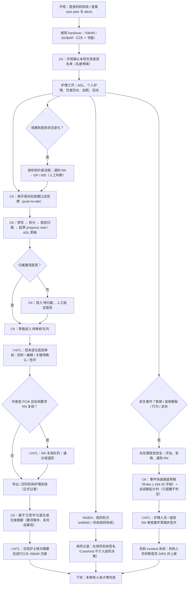
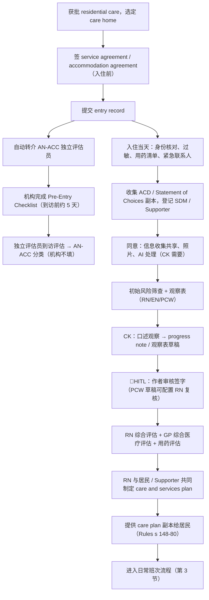
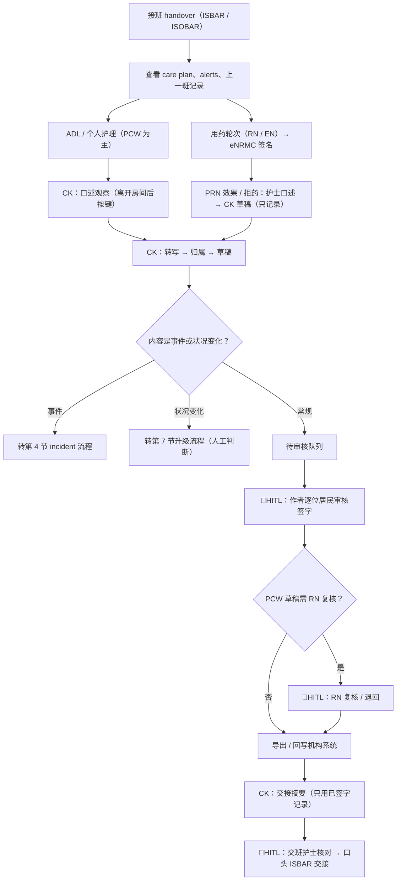
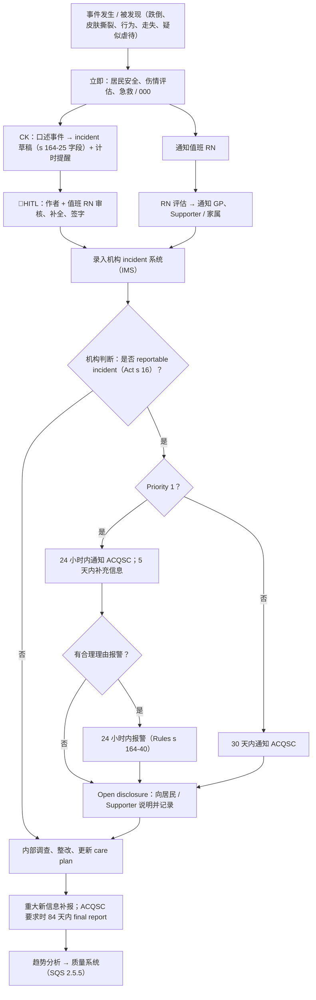
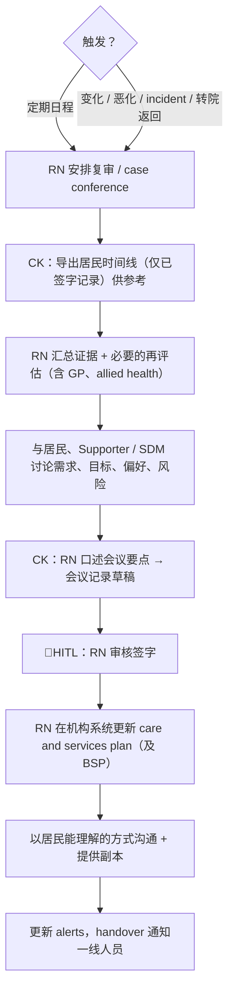
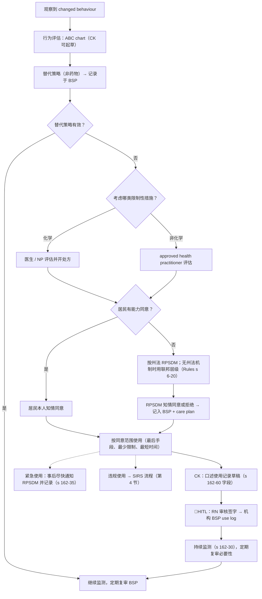
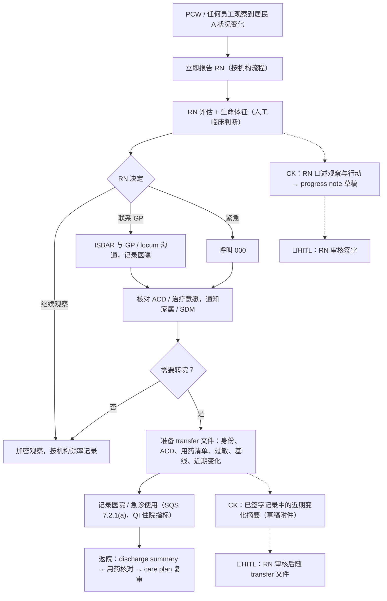
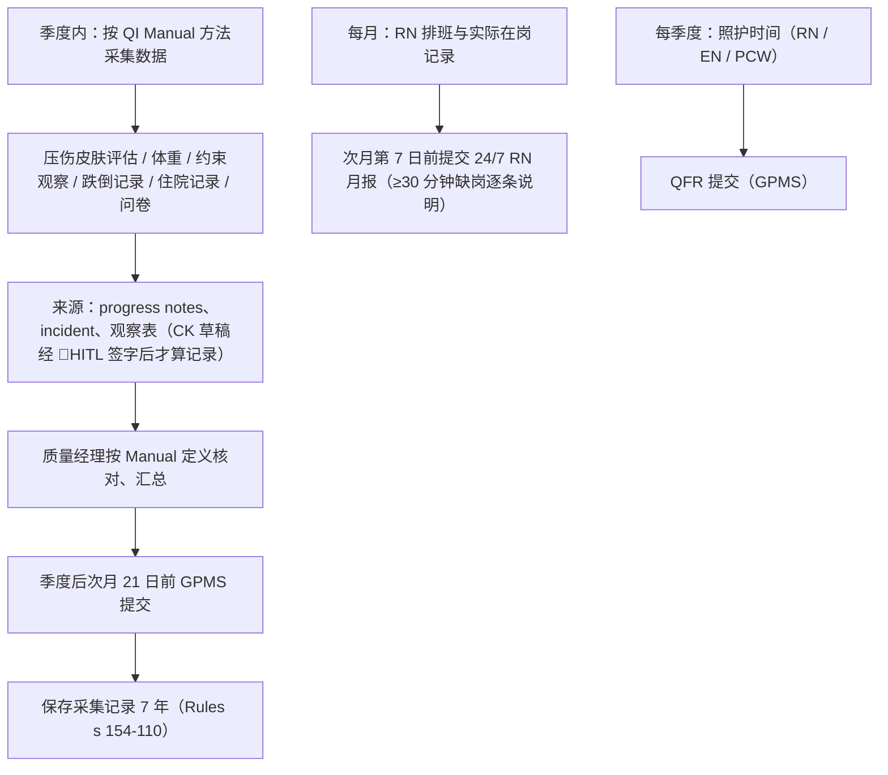
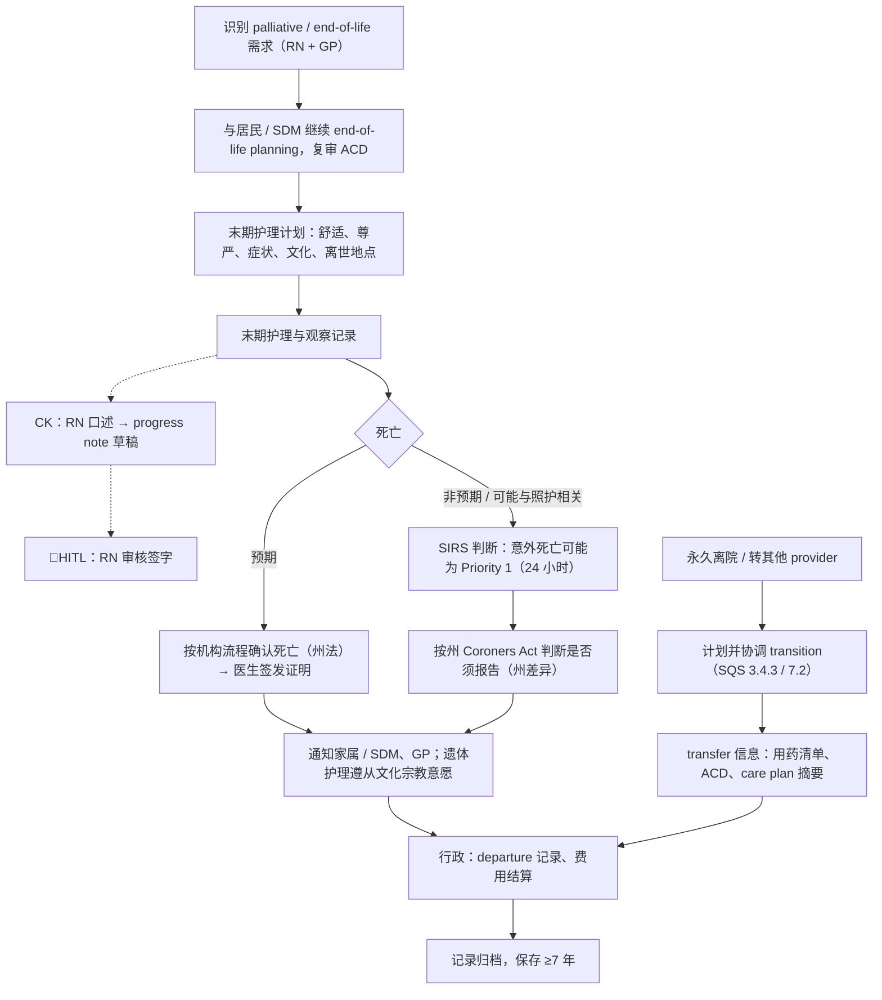
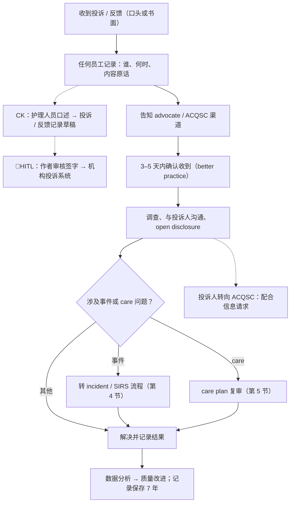

# 澳洲养老护理真实文档工作流程 Aged Care Documentation Workflows（Deliverable D）

> **内部工作底稿，非法律意见、非临床意见。** 核查日期：**2026-10-19**。Owner：Terry（待 Clinical Lead 到岗后复核临床流程部分）｜ 复审：每季度，或 Aged Care Rules 2025 新汇编发布时。
> 标记：【未核实】= 未能在一手官方来源核实，或各机构/各州做法不同，使用前须核对。示例只用"居民 A / 居民 B"，不含任何真实居民信息。
> 配套文件：[aged-care-paperwork-checklist.md](aged-care-paperwork-checklist.md)（Paperwork 总表）。在 [paperwork-templates-index.md](paperwork-templates-index.md)（已下载模板索引）、[federal-law-summary.md](federal-law-summary.md)（联邦法条）、[state-by-state-comparison.md](state-by-state-comparison.md)（州差异）基础上补充**流程视角**，不重复法条细节。

## 0. 怎么读这份文件

- 第 1 节：一张全景图——一个日常班次里文档在哪产生、CareKind 在哪介入、HITL 审核点在哪。
- 第 2–10 节：9 个流程。每个流程固定结构：**触发条件 → 参与角色 → 步骤与时限 → 产生的文档 → 法规依据 → CareKind 可介入 / 不可介入** + Mermaid 流程图。
- 第 11 节：临床文档 best practice（18 条）；第 12 节：AI 生成文档 best practice（14 条）。
- 第 13 节：未核实项与需 Clinical Lead / 律师确认的问题。

**角色缩写**：RN（Registered Nurse）、EN（Enrolled Nurse）、PCW/AIN（Personal Care Worker / Assistant in Nursing，非 Ahpra 注册）、CM（Clinical Care Manager / DON / Facility Manager）、GP（全科医生，外部）、NP（Nurse Practitioner）、SDM（Substitute Decision-Maker，含 RPSDM）、Supporter（Aged Care Act 2024 下的 registered supporter / 家属）。

**产品边界提醒（适用于全文）**：CareKind 只把护理人员**亲口说出的**观察和行动整理成草稿；不做诊断、不给治疗/用药建议、不做风险评分或恶化预警、不替机构判定 SIRS 等级、不向监管机构提交任何东西。所有 AI 草稿必须由护理人员审核签字后才进入记录（PRD C4、[TGA Digital scribes](https://www.tga.gov.au/node/513526)、[clinical-safety-framework](../../06-app-development/clinical-safety-framework.md)）。

### 0.1 核心法规速查（全文反复引用）

| 简称 | 内容 | 官方来源 |
|---|---|---|
| Act | *Aged Care Act 2024*（2025-11-01 生效） | https://www.legislation.gov.au/C2024A00104/latest/text |
| Rules | *Aged Care Rules 2025*（频繁汇编，引用前查最新版） | https://www.legislation.gov.au/F2025L01173/latest/text |
| SQS | Strengthened Aged Care Quality Standards（2025-11 版；本地 PDF 2026-08 上传） | https://www.health.gov.au/sites/default/files/2026-08/strengthened-aged-care-quality-standards_0.pdf |
| SIRS 快速指南 | Reportable incidents and SIRS – changes from 1 Nov 2025 | https://www.agedcarequality.gov.au/sites/default/files/media/reportable-instances-sirs-guide.pdf |
| NMBA | Code of conduct for nurses（2018）；RN / EN Standards for practice | https://www.nursingmidwiferyboard.gov.au/codes-guidelines-statements/professional-standards |
| ACSQHC | AI Clinical Use Guide（2025-08）；AI Safety Scenario – Ambient scribe；NSQHS Communicating for Safety | https://www.safetyandquality.gov.au/our-work/digital-health/artificial-intelligence |
| Ahpra | Meeting your professional obligations when using AI in healthcare | https://www.ahpra.gov.au/Resources/Artificial-Intelligence-in-healthcare.aspx |

---

## 1. 全景图：一个日常班次 + CareKind 介入点

说明：未标记的节点是机构原有流程；标 **CK** 的节点是 CareKind 介入点；标 **🛑HITL** 的节点是"AI 草稿必须由人审核才能进入正式记录"的闸门。机构护理系统（eCase、Leecare、AutumnCare、Telstra Health 等）始终是正式记录库（PRD C7）。

**关键设计含义**

1. HITL 闸门有 4 个：普通草稿签字（H2）、事件草稿签字（H1）、PCW→RN 复核（H3）、交接摘要核对（H4）。签字前草稿不得进入时间线、交接摘要或导出。
2. 事件和恶化**先处理居民，后记录**——CareKind 的入口永远在临床处置之后，不能出现在"是否打 000 / 叫 GP"的决策路径上。
3. 用药记录走机构的电子用药系统（eNRMC 等）；CareKind 最多把护士口述的"已给 PRN、效果如何"整理进 progress note，不生成、不校对给药记录。

---

## 2. 入住 Admission

**触发条件**：老人经 Single Assessment System 评估获批 residential care，选定 care home，确定入住日期（permanent 或 respite）。

**参与角色**：CM / Admissions officer（协议、资金）、RN（入住评估、care plan 初稿）、EN/PCW（基础观察、个人偏好收集）、GP（comprehensive medical assessment、处方、用药清单）、居民本人、Supporter / SDM / 家属、独立 AN-ACC assessor（外部）、药剂师（用药评估）。

### 2.1 步骤与时限

| # | 步骤 | 时限 / 要求 | 依据 |
|---|---|---|---|
| 1 | 入住前：签署 **service agreement**（及 accommodation agreement），说明服务与费用 | 新法下应在入住**前**订立；health.gov.au 写明 28 天 cooling-off；My Aged Care 页面写 14 天 cooling-off——两者冲突【未核实】；无协议的现有永久居民须在 2026-11-01 前补签 | https://www.health.gov.au/our-work/residential-aged-care/managing/service-agreements ；https://www.myagedcare.gov.au/agreeing-aged-care-home |
| 2 | 提交 entry record → 自动生成 AN-ACC 评估转介；机构在评估员到访前约 5 天完成 Pre-Entry Checklist | 评估由独立评估员完成（约 90% 在 28 天内完成——Department 数据，非法定时限） | https://www.health.gov.au/our-work/single-assessment-system/funding/before-providing-services ；https://www.health.gov.au/our-work/AN-ACC |
| 3 | 入住当天：身份核对、过敏史、当前用药清单、紧急联系人、advance care directive（ACD）副本、初始风险筛查（跌倒、皮肤、营养、吞咽、疼痛、认知、行为） | 过敏须在服务开始时记录（SQS 5.3.3）；ACD 须被存储并在转院时共享（SQS 3.1.6(d)） | SQS 3.1、3.3.2(a)、5.3.3、5.4.2 |
| 4 | 入住评估期（常见 "21 天评估期"，各机构流程不同【未核实，非法定】）：分项评估 + 观察表（bowel chart、fluid/food chart、sleep chart、behaviour/ABC chart 等） | 法定只要求"服务开始时"做综合临床评估并协助获得 GP 综合医疗评估（SQS 5.4.2(a)） | SQS 5.4.2 |
| 5 | 制定 **care and services plan**（与居民/Supporter partnership），提供副本 | Rules s 148-80：start day 前制定（部分情况 28 天内）；制定或更新后及应要求向本人提供副本 | Rules s 148-80（见 [federal-law-summary.md](federal-law-summary.md) §1.4） |
| 6 | 用药评估（medication review） | 服务开始时、转院时、此后每年（SQS 5.3.2(a)） | SQS 5.3.2 |
| 7 | 同意类文件：信息收集/共享同意、照片、AI 处理同意（CareKind 场景）、restrictive practice（如适用，见第 6 节） | 信息收集、使用、披露须取得知情同意（SQS 2.7.2(c)）；Ahpra：AI 转录"首步明确同意" | SQS 2.7；Ahpra AI 指南 |

### 2.2 产生的文档

Service agreement / accommodation agreement；entry record；AN-ACC assessment（评估员产生，机构不填）；入住评估表（各分项）；过敏与用药清单；ACD / Statement of Choices 副本（各州表格见 [paperwork-templates-index.md](paperwork-templates-index.md) §9）；SDM / Supporter 登记；care and services plan 初稿；各类观察表；同意记录；首次 progress notes。

### 2.3 CareKind 介入 vs 不介入

| 可以介入（草稿 + HITL） | 不能介入 |
|---|---|
| 把 RN 口述的入住观察、居民亲口表达的偏好（"居民 A 喜欢早上先喝茶"）整理成 progress note 草稿，偏好标记来源 | AN-ACC 评估（独立评估员职责；也不得为"提高分类"诱导记录——资金欺诈风险，[aged-care-alignment.md](../aged-care-alignment.md)） |
| 观察表的口述录入（"午餐吃了一半，喝水 200 ml"）→ 结构化草稿 | 生成风险评分（Braden、跌倒风险评分等）或给出"高风险"标签 |
| 按机构模板把 RN 口述的评估内容放进 care plan **草稿字段**（RN 审核后在机构系统定稿） | 起草或解释 ACD 内容；判断居民是否有决策能力；替机构收集同意 |
| 提示"模板字段未记录"（如"未记录过敏史来源"）——只提示字段完整性 | 签署或代填 service agreement；任何财务/费用内容 |

**居家（Support at Home）差异**：服务协议 + care and services plan + 预算；care management 活动记录；**monthly statements**（Rules s 155-40）；care plan 每 12 个月至少复审（Rules s 148-80）。参考 Support at Home Program Manual v4.4（本地已下载，https://www.health.gov.au/sites/default/files/2026-09/support-at-home-program-manual-a-guide-for-registered-providers_0.pdf）。

---

## 3. 日常班次 Daily Shift

**触发条件**：每个班次（常见 AM / PM / Night，8 小时或 10/12 小时轮班）。

**参与角色**：RN（全班临床负责、用药、复核、升级；24/7 RN 要求下每个 care home 时刻至少 1 名 RN 在岗——Act s 175）、EN（在 RN 指导下用药与护理）、PCW（ADL 与个人护理，是记录的主要作者）、CM（日间）。

### 3.1 步骤

| # | 步骤 | 文档 | 依据 / 要点 |
|---|---|---|---|
| 1 | **Shift start handover**：交班 → 接班，结构化（ISBAR / ISOBAR），常在护士站 + 床旁 | Handover sheet / 机构系统 handover 报告 | SQS 3.3.2(d)：handover 时须使用结构化沟通系统；ACSQHC ISBAR（本地 PDF） |
| 2 | 查看 care plan、alerts、上一班 progress notes | — | SQS 3.1.4(e)：care plan 须被工作人员使用以指导服务 |
| 3 | ADL / 个人护理：洗浴、穿衣、如厕、翻身、进食饮水、活动 | ADL chart、repositioning chart、fluid/food chart、bowel chart、skin chart | SQS 3.2、5.5（高影响高发风险：吞咽、失禁、皮肤等） |
| 4 | 用药轮次（RN/EN；部分州/机构允许受训 PCW 协助自服药【未核实，州差异】） | 电子用药记录（eNRMC）、PRN 用药及效果记录、拒药记录 | SQS 5.3.1(e)：记录全部药物与临床理由，含 PRN |
| 5 | **Progress notes**：按机构政策（常见"有变化时 + 每班/每日至少一次"【未核实，机构政策】）记录观察、护理、居民表达、家属沟通 | Progress notes | SQS 2.7（accurate and current）；NMBA RN 标准 1.6、EN 标准 7 |
| 6 | 发现变化 → 升级（见第 7 节）；发生事件 → incident（见第 4 节） | 升级记录、incident form | SQS 3.3（恶化须上报与沟通） |
| 7 | 班末：补齐记录、RN 复核 PCW 记录（如机构要求） | 签名 / 会签 | NMBA Decision-making framework（委派与监督） |
| 8 | **交班 handover**：ISBAR / ISOBAR | Handover 报告 | SQS 3.3.2(d) |

**ISBAR / ISOBAR 结构**（ACSQHC 海报，本地 `downloads/clinical-handover/ACSQHC_ISBAR-Poster.pdf`；ISOBAR 多一个 **O = Observations**，部分州卫生部使用【未核实具体出处】）：

| 字母 | 含义 | CareKind 能否起草 |
|---|---|---|
| I Identify | 交班人、居民身份 | ✅ 从签字记录带出（居民身份经两要素确认，hazard H-03） |
| S Situation | 当前情况 | ✅ 仅护理人员已陈述的内容 |
| B Background | 相关背景 | ✅ 仅来自已签字记录 / care plan 摘录 |
| O Observations | 观察数据 | ✅ 仅护理人员口述或已记录的数值，不标"偏低/异常" |
| A Assessment | 评估（海报示例含"at risk of…"这种临床判断） | ⚠️ **只能逐字整理护士本人说出的评估**，不得自动生成 |
| R Recommendation | 建议 / 请求 | ⚠️ 同上；CareKind 不生成任何护理或治疗建议（TGA 边界） |

### 3.2 CareKind 介入 vs 不介入

| 可以介入 | 不能介入 |
|---|---|
| 班次中 push-to-talk 口述 → 自动归属 → progress note / ADL / 观察表草稿（PRD D2） | 给药决策、剂量核对、药物相互作用提示、"该给 PRN 了"提醒 |
| PCW 母语口述 → 英文草稿 + 原文对照（hazard H-07） | 把 fluid/food 数据判断为"不足"或预警（不做恶化识别） |
| 班末按居民分组审核、PCW→RN 复核队列（PRD D4） | 替 RN 完成会签；自动签字；把未签字草稿写入机构系统 |
| 基于已签字记录生成交接摘要（PRD D5）；口头交接仍按机构流程 | 生成 ISBAR 的 A / R 中护士未说过的内容 |

---

## 4. 事件 / 事故 Incident → SIRS → Open Disclosure

**触发条件**：跌倒、皮肤撕裂（skin tear）、压伤新发、用药差错、行为事件（居民间攻击）、不明原因缺席（unexplained absence）、疑似虐待/疏忽、意外死亡、near miss。

**参与角色**：发现人（常为 PCW）、值班 RN（评估、急救、通知 GP/家属、填写 incident）、CM / SIRS 负责人（判定是否 reportable 及 Priority、向 ACQSC 提交）、GP、家属/Supporter/SDM、警方（如适用）、ACQSC。

### 4.1 步骤与时限

| # | 步骤 | 时限 | 依据 |
|---|---|---|---|
| 1 | 立即确保居民安全：评估伤情、急救、必要时 000；跌倒后按机构 post-falls 流程观察（如 neuro obs，机构政策【未核实】） | 立即 | SQS 2.5.2（及时响应）、5.4.4(c) |
| 2 | 通知 RN → GP、Supporter / 家属 | "timely notification"——无固定小时数 | SQS 5.4.4(d) |
| 3 | 填写 **incident form**（机构 IMS），至少包含 Rules s 164-25(1) 的 13 项字段（描述、伤害、时间地点、发现时间、涉事人及证人、评估、采取的行动、与受影响者的沟通、是否 reportable、调查、记录人、报警详情等） | 机构政策（通常本班内完成【未核实，机构政策】） | Rules s 164-25；保存 7 年（s 154-150） |
| 4 | 判断是否属于 8 类 **reportable incident**（Act s 16）及 Priority | 由机构人员判断 | Act s 16；SIRS 快速指南 |
| 5 | **Priority 1** → 通知 ACQSC | 知悉后 **24 小时内**；当时无法提供的信息在**随后 5 天内**补充 | SIRS 快速指南（https://www.agedcarequality.gov.au/sites/default/files/media/reportable-instances-sirs-guide.pdf）；Rules s 165A-25 |
| 6 | **Priority 2** → 通知 ACQSC | 知悉后 **30 个日历日内** | 同上；Rules s 165A-30 |
| 7 | 有合理理由时报警 | 24 小时内 | Rules s 164-40 |
| 8 | 重大新信息补报 | 尽快合理可行 | Rules s 165A-40 |
| 9 | Commissioner 要求的 final report | 首次通知后 **84 天**内（或指定期限） | Rules s 165A-45 |
| 10 | **Open disclosure**：向居民 / Supporter 承认、道歉、说明事实与后续措施，并记录 | 尽快（无法定小时数） | SQS 2.3.6（"practices open disclosure… when things go wrong"）；ACQSC Open disclosure 资源 https://www.agedcarequality.gov.au/resources/open-disclosure |
| 11 | 调查、根因分析、整改；更新 care plan（事件属 care plan 复审触发条件，SQS 3.1.5(e)） | 机构政策 | SQS 2.5.1、2.5.5、2.5.6 |

Priority 1 定义（2025-11-01 起）：造成需由医生/NP/RN/心理学家/社工才能提供的医疗或心理治疗的伤害；有合理理由报警；非法性接触或不当性行为；服务导致的意外死亡；有合理理由报警的不明缺席。**无法表达的居民（如认知障碍）也可能已受影响**，须评估行为变化（SIRS 快速指南）。其余 reportable incident 为 Priority 2。

### 4.2 产生的文档

Incident form（IMS）；post-incident 观察记录（如 neuro obs chart）；progress notes；GP / 家属通知记录；SIRS notification（My Aged Care Provider Portal 提交【未核实具体入口名称】）；final report（如要求）；open disclosure 记录；调查 / RCA 报告；care plan 更新；（如涉及）警方报告编号。

### 4.3 CareKind 介入 vs 不介入

| 可以介入 | 不能介入 |
|---|---|
| 事件快速通道：口述 → incident 草稿，字段映射 s 164-25；立即推送给作者 + 值班 RN（PRD C5 / D3） | 判定是否 reportable、是否 Priority 1/2 |
| "未记录：发现时间 / 证人 / 已通知谁"——**只提示记录字段**，不提示临床结论 | 向 ACQSC、警方提交任何内容；替机构"建议上报" |
| 显示"这可能需要按机构流程判断是否须上报（SIRS）"及自观察时间起的计时器 | 推断伤害程度（"可能骨折"）或原因（"因地面湿滑"——除非护士亲口说） |
| 起草 open disclosure 沟通**记录**（护士口述"已于 X 时与居民 A 女儿通话说明"） | 起草对家属的道歉话术或法律措辞；评估责任 |

**居家差异**：SIRS 自 2025-11-01 覆盖 Support at Home，时限相同；"missing consumer"已并入"unexplained absence"（SIRS 快速指南）。

---

## 5. Care Plan Review 与 partnership

**触发条件**：(a) 定期复审（residential：法规写"regularly"，机构常见每 3–6 个月 + 年度 case conference【未核实，非法定】；居家：至少每 12 个月——Rules s 148-80）；(b) SQS 3.1.5 列明的变化：需求/目标/偏好改变或计划无效；ADL、心理、认知、身体功能或状况变化或恶化；家属照护能力改变；转院等 transition；风险出现、变化或 incident；照护责任变更。

**参与角色**：RN（主导复审）、居民本人、Supporter / SDM / 家属（经居民同意）、GP、allied health（物理治疗、营养、言语病理等）、PCW（提供日常观察）、CM。

### 5.1 步骤

| # | 步骤 | 依据 |
|---|---|---|
| 1 | 触发识别（定期日程或事件/变化） | SQS 3.1.5 |
| 2 | 汇总证据：近期 progress notes、观察表、incident、转院、用药评估、allied health 意见 | SQS 3.1.1、5.4.5 |
| 3 | 重新评估（必要时使用标准化工具，由 RN / allied health 执行） | SQS 5.4.2 |
| 4 | **Partnership**：与居民 / Supporter 讨论需求、目标、偏好、风险策略（case conference） | SQS 3.1.2、3.4.2；Statement of Rights（Act s 23） |
| 5 | 更新 care and services plan；涉及 restrictive practice 时同步更新 BSP | SQS 3.1.4；Rules s 162-45 起 |
| 6 | 向居民（以其能理解的方式）及经同意的 Supporter 沟通结果、提供副本 | SQS 3.1.3、3.1.4(d)；Rules s 148-80 |
| 7 | 通知一线人员（handover、alerts） | SQS 3.3 |

**Monthly care statements**：health.gov.au 的 Monthly Care Statements 仍为**自愿**（2024-10-01 起自愿期），强制时间未定；但 SQS 3.3.4(b) 已写入"provide care statements to individuals in residential care homes"——两者关系【未核实】。来源：https://www.health.gov.au/our-work/monthly-care-statements-for-residential-aged-care 。

### 5.2 CareKind 介入 vs 不介入

| 可以介入 | 不能介入 |
|---|---|
| 汇总某居民一段时间内**已签字记录**的时间线（按类型筛选），供 RN 复审参考（PRD D6） | 自动判断"需要复审"、"计划无效"或给出护理目标/干预建议 |
| 把 case conference 中 RN 口述的讨论要点和居民原话整理成会议记录草稿 | 自动改写 care plan；把草稿直接写进机构 care plan |
| 居民偏好（来源可追溯）汇总，帮助 partnership 讨论 | 推断居民偏好或替居民"总结意愿" |

---

## 6. 限制性措施 Restrictive Practices / Behaviour Support Plan

**触发条件**：居民出现"changed behaviours"（BPSD），机构考虑或已经（含紧急情况下）使用 5 类限制性措施之一：chemical、environmental、mechanical、physical restraint、seclusion（Rules s 17-5；仅适用 residential，Rules s 162-5）。

**参与角色**：RN（评估、BSP、监测记录）、approved health practitioner（非化学约束的评估）、GP / NP（化学约束：评估、处方、取得知情同意）、居民或 **RPSDM**（知情同意）、Dementia Support Australia 等外部支持、CM。

### 6.1 步骤

| # | 步骤 | 依据 |
|---|---|---|
| 1 | 识别行为 → 行为评估（ABC chart 等，记录诱因、行为、后果） | NSW Health BPSD 手册（本地） |
| 2 | 先采用替代策略（非药物）并在 BSP 中记录已考虑 / 使用的策略及结果 | Rules s 162-15 |
| 3 | 如仍考虑限制性措施：评估（非化学：approved health practitioner，s 162-20；化学：医生 / NP，s 162-25） | Rules s 162-20 / 162-25 |
| 4 | **知情同意**：居民本人；无能力时按州法确定的 RPSDM；州法无机制时用联邦层级（Rules s 6-20）；须说明使用情境、频率、持续时间、复审时间、监测方式，并提供 BSP 副本；同意或拒绝都须记录在 BSP 与 care plan | DoHDA RPSDM fact sheet 2026-02（本地）；https://www.health.gov.au/topics/aged-care/providing-aged-care-services/working-in-aged-care/restrictive-practices |
| 5 | 使用期间监测：困扰/伤害迹象、副作用、情绪行为变化、福祉、ADL 能力；定期复审必要性并记录 | Rules s 162-30 |
| 6 | 每次使用后记录：开始时间、持续时间、频率、结果、是否符合同意、参与人员、监测与复审结果 | Rules s 162-60 |
| 7 | 紧急使用：事后尽快通知 RPSDM，在 BSP 中记录行为、替代策略、理由、后续照护 | Rules s 162-35 |
| 8 | 违规使用 = reportable incident → 第 4 节 SIRS 流程 | Act s 16(1)(g) |
| 9 | QI Program 中的 restrictive practices 指标（季度） | 第 8 节 |

### 6.2 CareKind 介入 vs 不介入

| 可以介入 | 不能介入 |
|---|---|
| 口述 → RP 使用记录草稿（开始/结束时间、触发行为、已尝试的替代策略、监测观察）——字段对齐 s 162-60 | **建议**使用任何限制性措施、药物或剂量；建议"替代策略" |
| ABC chart 口述录入（护士描述的诱因-行为-后果） | 判断行为原因、诊断 BPSD 或谵妄 |
| 提示"未记录：持续时间 / 是否通知 RPSDM"（字段完整性） | 判定使用是否"合规"、是否须上报 SIRS |
| BSP use log 草稿汇总（RN 审核后入机构 BSP） | 代取或记录"已获同意"——同意状态只能由机构人员录入 |

注意：ACQSC BSP fact sheet 警告"避免复制粘贴式模板"（本地 PDF）——AI 草稿必须基于本次口述，禁止从过往记录复制行为描述。

---

## 7. 临床恶化识别与升级、转院 / 医院交接

**触发条件**：护理人员观察到居民状况变化（进食饮水下降、意识/行为改变、跌倒后、疼痛加重、呼吸变化、生命体征改变等）。**识别与判断是人的职责**；本节流程只描述机构如何记录与沟通。

**参与角色**：PCW（发现并报告）、RN（评估、生命体征、决定升级）、GP / 夜间 locum / 远程医疗、NP、救护车、医院急诊、家属 / SDM（ACD 意愿）、接收医院。

### 7.1 步骤

| # | 步骤 | 依据 |
|---|---|---|
| 1 | PCW 观察到变化 → 立即报告 RN（机构通常有"report to RN"清单【未核实，机构政策】） | SQS 3.3（恶化须上报与沟通）、3.3.3（升级流程） |
| 2 | RN 评估、测量生命体征，按机构的升级流程（多基于 ACSQHC 恶化识别原则）决定：继续观察 / 联系 GP / 呼叫救护车 | SQS 5.4（早识别、早响应）；ACSQHC 恶化识别资源 https://www.safetyandquality.gov.au/standards/nsqhs-standards/recognising-and-responding-acute-deterioration-standard （医院标准，作参考） |
| 3 | 用 ISBAR 与 GP / 救护沟通；核对 ACD / 治疗限制意愿 | ACSQHC ISBAR；SQS 3.1.6(d) |
| 4 | 通知家属 / SDM | SQS 5.4.4(d) |
| 5 | 转院：准备 transfer 文件（居民身份、ACD、用药清单、过敏、基线功能、近期变化、联系人） | SQS 7.2.1(d)（及时、最新、完整的信息）；5.3.1(b)（转院时可获取最新用药清单） |
| 6 | 记录医院 / 急诊使用（亦为 QI 住院指标数据来源） | SQS 7.2.1(a)；QI Manual Part A（hospitalisation） |
| 7 | 返院：接收 discharge summary，用药核对（medication reconciliation）与用药评估，复审 care plan | SQS 7.2.1(e)、5.3.2(a)、3.1.5(d) |

### 7.2 CareKind 介入 vs 不介入

| 可以介入 | 不能介入（TGA 红线） |
|---|---|
| 把 RN 口述的观察、所做的升级行动（"21:10 联系 GP，GP 嘱……"）整理进 progress note 草稿 | 任何形式的恶化识别、早期预警评分、"偏低/异常"标记、趋势告警 |
| 把**护士已陈述**的内容整理成 ISBAR 格式草稿供其通话前核对 | 生成 ISBAR 的 Assessment / Recommendation；建议是否叫救护车 |
| 从已签字记录汇总"近期护士记录到的变化"作为 transfer 文件草稿附件（需 RN 审核） | 生成用药清单或用药核对结果（必须来自机构用药系统） |
| 返院后把 RN 口述的交接要点整理成记录 | 解读 discharge summary 或推荐 care plan 修改 |

---

## 8. 质量指标 QI Program 与 Care minutes / 24/7 RN 报告

### 8.1 QI Program

**触发条件**：每季度（residential care homes 强制）。

**指标**（QI Manual Part A 2026-10，本地 PDF）：pressure injuries、restrictive practices、unplanned weight loss、falls and major injury、medication management、activities of daily living、incontinence care、hospitalisation、workforce、consumer experience、quality of life、recommended allied health services received；enrolled nursing、lifestyle officers 等由 Department 从 QFR 数据计算。

**时限**：每季度结束后次月 **21 日 23:59** 前通过 GPMS 提交（即 1/21、4/21、7/21、10/21）——https://www.health.gov.au/our-work/qi-program/how-the-program-works ；QI 记录保存 7 年（Rules s 154-110）。

**参与角色**：RN / Clinical manager（按 Manual 方法采集：如压伤全身皮肤评估、体重测量、约束观察）、质量经理（汇总提交）、居民（consumer experience / QoL 问卷）。

### 8.2 Care minutes / 24/7 RN

| 报告 | 时限 | 依据 |
|---|---|---|
| 24/7 RN 月报：逐日是否全时有 RN 在岗；每段 ≥30 分钟缺岗的时段、原因、替代安排 | 每月结束后第 **7 个日历日 23:59（AEST/AEDT）** 前；逾期不获该期 supplement | Act s 175；Rules s 166-855；DoHDA 24/7 RN guide 2026-03（本地 PDF，§5.4） |
| Care minutes：在 Quarterly Financial Report（QFR）中报告每个 home 的照护时间；行业平均目标 215 分钟/居民/日（含 RN 44 分钟） | QFR 法定截止日（指南以图表列出，具体日期【未核实】） | Act s 176；Rules s 176-15、166-340；https://www.health.gov.au/our-work/AN-ACC/providers/care-minutes |

**对 CareKind 的重要发现**：Care minutes guide（2026-05，本地 PDF §4）写明直接照护活动"may include… direct care activities that are not undertaken face-to-face (for example, writing up care plans or organising a referral…)"——即**部分文档工作本身可计入 care minutes**。这修正了 [federal-law-summary.md](federal-law-summary.md) §1.8 中"文档时间一般不计入"的推测；ROI 叙事不能简单说"节省的文档时间 = 新增 care minutes"。哪些文档活动可计入需按指南 Appendix 2 逐项核对【未核实】。

### 8.3 CareKind 介入 vs 不介入

| 可以介入 | 不能介入 |
|---|---|
| 未来：从已签字记录中**结构化汇总**跌倒、皮肤、体重、约束等记录，供质量经理按 Manual 方法核对（需单独评估准确性，[aged-care-alignment.md](../aged-care-alignment.md)） | 直接生成或提交 QI 数据到 GPMS |
| — | 计算 care minutes、RN 缺岗或排班数据（非文档范围） |
| — | 用 QI 结果给单个居民打风险分 |

---

## 9. 临终护理、死亡、出院 / 离院

**触发条件**：(a) 居民被识别为需要 palliative care 或接近生命终点；(b) 死亡（预期或非预期）；(c) 永久离院（转往其他 care home、回社区）或 leave（住院、社交假期）。

**参与角色**：RN（症状观察记录、末期护理计划执行、死亡后流程）、GP / NP / 专科姑息团队（处方、末期用药、死亡证明）、居民、SDM / 家属、牧灵 / 文化支持、CM（离院通知、费用结算）、殡仪服务、Coroner（如属须报告死亡）。

### 9.1 步骤

| # | 步骤 | 依据 |
|---|---|---|
| 1 | 识别 palliative / end-of-life 需求；与居民、SDM 继续 end-of-life planning 对话；复审 ACD | SQS 5.7.1、5.7.2 |
| 2 | 末期护理计划：舒适与尊严、疼痛与症状管理、精神文化需求、偏好的离世地点；告知员工与家属 | SQS 5.7.3 |
| 3 | 末期观察记录（舒适护理、口腔护理、疼痛、症状、家属陪伴） | SQS 5.7.3(c) |
| 4 | 死亡：预期死亡按机构流程确认（RN 能否 verify death 依州法与机构政策【未核实】）；医生签发死亡医学证明 | 州法【未核实】 |
| 5 | 非预期死亡、与照护相关的死亡：可能属 **SIRS Priority 1（意外死亡）**→ 24 小时；是否须向 Coroner 报告依州 Coroners Act【未核实，州差异】 | SIRS 快速指南；Act s 16 |
| 6 | 通知家属 / SDM、GP；遗体护理遵从文化宗教意愿；记录 | SQS 5.7（家属在最后日子中被告知与支持） |
| 7 | 离院 / 死亡的行政通知（Services Australia / Department 系统中的 departure 记录，时限【未核实】）；费用结算 | 【未核实】 |
| 8 | 转出至其他 provider：计划并协调 transition，记录与沟通 | SQS 3.4.3、7.2 |
| 9 | 记录归档并按 7 年（NSW/VIC/ACT 为最后服务后 7 年）保存 | Rules s 154；[state-by-state-comparison.md](state-by-state-comparison.md) §6 |

### 9.2 CareKind 介入 vs 不介入

| 可以介入 | 不能介入 |
|---|---|
| 把 RN 口述的末期观察、舒适护理、家属陪伴与沟通整理成 progress note 草稿（语言须尊严、居民为中心） | 判断"进入临终期"、给出预后或症状管理建议 |
| 把 end-of-life planning 对话中护士记录的居民原话整理为草稿（来源可追溯） | 起草、解释或修改 ACD；判断治疗限制 |
| 死亡后的流程性记录（"X 时已通知 GP、家属"） | 死亡确认 / 死亡证明；判断是否须报 Coroner 或 SIRS |

---

## 10. 投诉与反馈 Complaints & Feedback

**触发条件**：居民、Supporter、家属、员工或访客口头或书面提出投诉、意见或赞扬；或员工观察到居民表达不满。

**参与角色**：接收投诉的任何员工、CM / 投诉负责人、居民 / Supporter、advocate（OPAN）、ACQSC（外部投诉渠道）。

### 10.1 步骤与时限

| # | 步骤 | 时限 | 依据 |
|---|---|---|---|
| 1 | 接收并记录投诉（含口头投诉） | 立即 | SQS 2.6.1（receive, record, respond to and report） |
| 2 | 告知可使用 advocate、ACQSC 等渠道 | — | SQS 2.6.2/2.6.3 |
| 3 | 确认收到 | ACQSC better practice guide：尽快或 **3–5 天内** | https://www.agedcarequality.gov.au/sites/default/files/media/better_practice_guide_to_complaints_handling_in_aged_care_services_v4.pdf （2025-07） |
| 4 | 调查、与投诉人沟通、给出现实的解决时间预期；使用 open disclosure | 及时（SQS 2.6.4 "timely action"） | SQS 2.6.4 / 2.3.6 |
| 5 | 解决、记录结果；若涉及事件 → 第 4 节；涉及 care → 第 5 节复审 | — | SQS 3.1.5 |
| 6 | 数据分析 → 质量改进；报告给居民与员工 | 定期 | SQS 2.6.5、2.6.6 |
| 7 | 若投诉人转向 ACQSC：配合信息请求；ACQSC 一般在 90 天内完结（目标 80% 在 60 天内） | 按 ACQSC 要求 | https://www.agedcarequality.gov.au/contact-us/complaints-feedback/our-complaints-process |
| 8 | 投诉与反馈记录保存 7 年 | — | Rules s 154-205 |

### 10.2 CareKind 介入 vs 不介入

| 可以介入 | 不能介入 |
|---|---|
| 护理人员口述"居民 A 女儿反映晚餐太凉"→ 生成**投诉/反馈记录草稿**（保留原话、标注来源），提醒"按机构投诉流程处理" | 判断投诉是否成立、分级或回复投诉人 |
| — | 自动分析员工个人表现或排名（亦违反 work-log 规则精神） |

---

## 11. 临床文档 Best Practice（18 条）

依据：NMBA Code of conduct for nurses（2018）§3.3、§3.5；RN Standards for practice（2016）1.6、5.3、7.3；EN Standards Standard 7；SQS Outcome 2.7、3.3；NSQHS Action 6.11（Documentation of information，医院标准，作为行业基准——https://www.safetyandquality.gov.au/standards/nsqhs-standards/communicating-safety-standard ）；ACQSC BSP fact sheet；ACSQHC ISBAR。

| # | Best practice | 依据 | CareKind 设计含义 |
|---|---|---|---|
| 1 | **Accurate**：只写看到、听到、做到的事实 | SQS 2.7（accurate and current）；RN 1.6 | 忠实性约束：草稿不得出现口述中没有的内容（hazard H-01） |
| 2 | **Contemporaneous / timely**：事件发生后尽快记录，注明观察时间与记录时间 | NSQHS 6.11（contemporaneously document）；RN 1.6（timely） | 保留口述时间戳；草稿区分"观察时间"与"签字时间" |
| 3 | **Objective**：用可观察描述代替主观标签（"居民 A 推开餐盘并说'我不饿'"而非"不合作"） | NMBA Code 3.3(e)（不以非专业方式指称他人） | 输出风格：保留可观察描述，不加评价词 |
| 4 | **Person-centred & respectful language**：使用居民偏好的称呼；避免"wanderer""feeder""difficult"等去人性化标签 | SQS Standard 1（dignity）；NMBA Code 3.3(e) | 术语表：去标签化；不做"美化"或改变事实 |
| 5 | 记录居民本人声音：原话、偏好、选择、拒绝 | SQS 1.3、3.1.2 | 原话加引号并可追溯到语句 |
| 6 | **Complete**：护理行动 + 结果 + 沟通对象（通知了谁、何时） | SQS 3.3；Rules s 164-25（事件） | 模板字段 + "未记录"提示（只针对字段） |
| 7 | 清晰、可读、可被不在场的人理解 | NSQHS 6.11；SQS 2.7（可被本人与他人理解） | 简明英文；避免机构外不认可的缩写 |
| 8 | 只用机构批准的缩写 | NSQHS 6.11 | 可配置缩写白名单 |
| 9 | **不复制粘贴**、不套用模板化重复描述 | ACQSC BSP fact sheet（避免复制粘贴式模板）【对 progress notes 的推广为行业惯例】 | 禁止从过往记录复制；每条草稿只来自本次口述 |
| 10 | 身份准确：正确居民、两要素识别 | SQS 3.3.4(a)（correctly identify and match individuals） | 归属引擎：低置信不自动归属；签字前确认居民（hazard H-03） |
| 11 | 签名可追溯：姓名、职位、日期时间 | RN 1.6；机构政策 | 签字记录 = 身份 + 时间戳 |
| 12 | **更正方式**：不删除、不涂改；原文保留，追加更正并注明原因、更正人与时间（late entry 标明为补记） | NMBA 记录原则【具体条款未核实】；Rules s 154-3（APP 13 更正）；ACT HRPA 不得更改/销毁记录 | 签字后只追加版本（PRD C4） |
| 13 | 在执业范围内记录；PCW 记录由 RN 按委派与监督框架复核 | NMBA Decision-making framework；RN 6.3/6.4 | PCW→RN 复核队列（PRD D4） |
| 14 | 恶化与风险：记录观察、升级行动和沟通对象，而非只写"已报告" | SQS 3.3、5.4.4(d) | 事件/变化草稿包含"通知了谁、何时" |
| 15 | 交接结构化（ISBAR / ISOBAR）并有书面支撑 | SQS 3.3.2(d)；ACSQHC ISBAR | 交接摘要只来源于已签字记录 |
| 16 | 同意须记录（信息共享、限制性措施、AI 使用） | NMBA Code 3.5(a)；SQS 2.7.2(c)；Rules s 162 | 同意状态由机构录入，CareKind 只读 |
| 17 | 保密：仅在参与照护且获授权时访问记录 | NMBA Code 3.5(d) | 权限：PCW 只看本班负责居民（PRD C6） |
| 18 | 记录可被居民查阅和更正 | SQS 2.7.2(d)；Act s 23(6)；NMBA Code 3.5(f) | 导出 PDF 含签字人、版本 |

---

## 12. AI 生成文档 Best Practice（14 条）

依据：ACSQHC *AI Clinical Use Guide* v1.0（2025-08）与 *AI Safety Scenario – Ambient scribe*（本地 PDF）；Ahpra *Meeting your professional obligations when using AI in healthcare*；TGA *Digital scribes*（https://www.tga.gov.au/node/513526 ）；Safer Care Victoria *Ambient AI Scribes* sector advisory（2025-05 / 发布 2025-07，https://www.health.vic.gov.au/sites/default/files/2026-06/ambient-ai-scribes-advisory.docx 【内容未逐条核对】）。NSW Health 已宣布在公立系统推行 AI scribe（2026-27 预算），但**未找到 NSW Health 面向临床人员的正式 AI scribe 指引**【未核实】；Qld、SA、WA 亦未找到州级正式指引【未核实】。

| # | Best practice | 依据 | CareKind 设计含义 |
|---|---|---|---|
| 1 | **临床人员对最终记录负全部责任**，AI 不转移责任 | ACSQHC Scenario（"Responsibility… remains with the clinician"）；Ahpra | 签字 = 作者确认；UI 文案明确 |
| 2 | **每份 AI 输出都须审核**，最好在互动结束时及时审核 | ACSQHC Scenario / Guide | 班末审核 + 事件立即审核；未审核 0 条才完成 |
| 3 | 审核时专门检查：幻觉、过度摘要、遗漏、偏见、近音词混淆（如 medication / mediation） | ACSQHC Scenario | 低置信高亮；药名/数字强制确认（hazard H-02） |
| 4 | 警惕 **automation bias** | ACSQHC Guide / Scenario | 关键项逐项确认；监测"零编辑确认率"（hazard H-08） |
| 5 | **知情同意 / 透明**：告知居民 AI 的用途、风险、审核机制及替代方式；记录同意；无同意时有一致处理方式 | ACSQHC Scenario；Ahpra（"explicit consent requirement as an initial step"） | 机构层同意状态；未同意居民不经 AI 处理（PRD D8） |
| 6 | 撤回同意：停止录音并删除相关数据和输出 | ACSQHC Scenario | 撤回立即生效；删除留审计日志 |
| 7 | 数据存储与处理在澳洲境内（除非取得明确离岸同意） | ACSQHC Scenario | 澳洲托管 + 澳洲区域推理（PRD C7） |
| 8 | **标注记录由 AI 参与生成** | ACSQHC Scenario（"Label records indicating AI was involved"） | 导出记录含"AI 辅助起草、由 X 审核"标记【需与客户系统字段对齐】 |
| 9 | 不生成从业者未陈述的诊断或治疗建议（否则可能成为医疗器械） | TGA Digital scribes；ACSQHC Scenario | 输出护栏 + 红队测试（hazard H-05） |
| 10 | 了解工具：训练/测试人群、预期用途、限制、数据去向、是否用于再训练 | Ahpra；ACSQHC Guide | 提供 intended purpose 声明与信任包；不用客户数据训练 |
| 11 | 录音型工具注意监听设备法，录私人对话未经同意可能有刑事责任 | Ahpra；ACSQHC Scenario | 按键口述模式 A；离开房间后口述（PRD B4） |
| 12 | 组织治理：PIA、性能监测、在治理会议上讨论正负面观察 | ACSQHC Guide / Scenario | 编辑率与错误报告看板给 DON；试点周会 |
| 13 | 报告 AI 相关不良事件和 near miss（向机构及外部） | ACSQHC Scenario | 一键"报告 AI 错误"；按 clinical-safety-framework 处理 |
| 14 | 产品更新可能悄悄引入新 AI 功能而绕过治理 | Safer Care Victoria advisory | 每次影响 AI 输出的发布做 TGA 定性复核 + 客户变更通知 |

**养老场景特有补充（推论，非官方原文）**：PCW 不受 Ahpra 注册约束（Aged Care Code of Conduct 适用），因此"PCW 审核自己的草稿 + 机构可配置 RN 复核"是把 Ahpra/ACSQHC 的"临床人员审核"原则落到养老一线的方式；多语言口述须显示原文对照，避免翻译改变临床含义（Act s 23(7)–(8)）。

---

## 13. 未核实项与待确认问题

| # | 项目 | 状态 / 下一步 |
|---|---|---|
| 1 | Service agreement cooling-off：health.gov.au 写 28 天、My Aged Care 写 14 天 | 【未核实】查 Rules 原文 |
| 2 | Accommodation agreement 是否取消入住后 28 天宽限 | 【未核实】Maddocks 2025-03 分析早于 Rules 定稿 |
| 3 | SQS 3.3.4(b) "care statements" 与 health.gov.au "自愿 Monthly Care Statements" 的关系 | 【未核实】查 May 2026 指南与 Rules |
| 4 | QFR 法定截止日（指南中为图片） | 【未核实】 |
| 5 | 哪些文档活动可计入 care minutes（指南 Appendix 2） | 【未核实】影响 ROI 叙事 |
| 6 | 入住"21 天评估期"、progress notes 频率、post-falls 观察频率 | 机构政策，非法定【未核实】，需在 30 次访谈中验证 |
| 7 | RN 能否 verify death、Coroner 报告范围、departure 通知时限 | 州法 / Services Australia【未核实】 |
| 8 | ISOBAR 官方出处；NMBA 关于"更正方式"的具体条款 | 【未核实】 |
| 9 | 州卫生部 AI scribe 指引（NSW、Qld、SA、WA） | 未找到正式文件【未核实】；Vic advisory 内容未逐条核对 |
| 10 | SIRS 提交入口（My Aged Care Provider Portal） | 【未核实】 |
| 11 | ACQSC Open disclosure framework 是否已按新法更新 | ACQSC 页面注明网站在更新中【未核实】 |
| 12 | "缺失字段提示""事件计时""交接摘要置顶"是否越过 TGA 边界 | 需律师 / 监管顾问确认（同 [README](README.md) 待确认事项 #4） |

**建议（需人批准，本文件未修改其他文件）**：(1) 在 `research/README.md` 索引中登记本文件与 paperwork checklist；(2) 修正 `federal-law-summary.md` §1.8 关于"文档时间不计入 care minutes"的表述；(3) Clinical Lead 到岗后复核第 2–10 节流程是否符合真实机构做法；(4) 用 30 次用户访谈验证"机构政策类"步骤。

## 来源

本地（`downloads/`）：DoHDA Strengthened Aged Care Quality Standards（2026-08）；ACQSC SIRS quick guide（2025-11）；DoHDA Consent for restrictive practices（2026-02）；DoHDA 24/7 RN guide（2026-03）；DoHDA Care minutes and 24/7 RN guide（2026-05）；DoHDA QI Program Manual Part A（2026-10）；NMBA Code of conduct（2018）、RN / EN standards；ACSQHC ISBAR poster、AI Clinical Use Guide、Ambient scribe scenario。

网络（2026-10-19 检索）：
- https://www.health.gov.au/our-work/residential-aged-care/managing/service-agreements
- https://www.myagedcare.gov.au/agreeing-aged-care-home
- https://www.health.gov.au/our-work/single-assessment-system/funding/before-providing-services
- https://www.health.gov.au/our-work/qi-program/how-the-program-works
- https://www.health.gov.au/our-work/monthly-care-statements-for-residential-aged-care
- https://www.agedcarequality.gov.au/resources/open-disclosure
- https://www.agedcarequality.gov.au/sites/default/files/media/better_practice_guide_to_complaints_handling_in_aged_care_services_v4.pdf
- https://www.agedcarequality.gov.au/contact-us/complaints-feedback/our-complaints-process
- https://www.safetyandquality.gov.au/standards/nsqhs-standards/communicating-safety-standard
- https://www.nationalstandards.safetyandquality.gov.au/6.-communicating-safety/documentation-information/documentation-information
- https://www.health.vic.gov.au/sites/default/files/2026-06/ambient-ai-scribes-advisory.docx
- https://medicalrepublic.com.au/nsw-health-commits-38-7m-to-ai-scribes-for-up-to-6000-clinicians/126906 （新闻，仅作背景）
