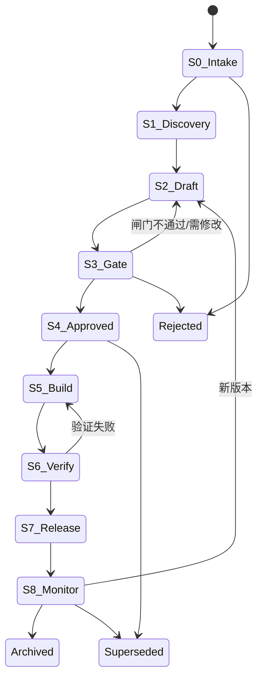

# ADLC —— AI 协作开发生命周期：任务分配、PRD 管理与状态记录

| 项 | 内容 |
|---|---|
| 文档 ID | SPEC-002（ADLC 上线后由登记表管理，见 §5） |
| 类型 | **内部研发流程与工具**（不属于 CareKind 产品范围，不处理居民数据） |
| 版本 | v0.1 草稿 · 2026-10-11 |
| Owner | Terry（Product Owner + Tech Lead） |
| 执行 | Ahmad、Matt、Dave；Claude Code、Codex（AI 执行者，须有人类负责人） |
| 状态 | 🟡 **待 Terry 审阅**（🛑 人工确认） |
| 目标上线 | 第一阶段：2026-11-06（M0 原型期间开始使用，见 §13） |
| 合规检查 | [有条件通过](../../03-legal-compliance/checks/2026-10-11_adlc.md) |
| 关联 | [docs/PRD.md](../../../docs/PRD.md) D10 内部研发工作流；[new-feature-gate](../../09-workflows/new-feature-gate.md)；[工程规范](../engineering-standards.md)；[AI 治理](../ai-governance.md)；[组织与角色](../../05-hr-teams/org-and-roles.md) |

> ⚠️ 本文中的法律判断为内部工作底稿，不构成法律意见。
> 本 spec 只定义研发流程与内部工具；不改变产品边界（TGA、录音模式、HITL、数据驻留），因此不需要 Type 1 DR。§14 列出建议的 Type 2 DR。

---

## 1. 背景与问题

ADLC（Agentic Development Lifecycle，AI 协作开发生命周期）指：**人类负责决策与批准，AI 助手（Claude Code、Codex）承担起草、编码、测试、检查等执行工作，每一步都有闸门、留痕和人类负责人**。CareKind 已经在用 AI 助手工作，但还缺少把"需求 → 任务 → 改动 → 验证 → 发布"连起来的流程。

现状问题（来自仓库现状，非用户访谈；本 spec 的用户是内部团队）：

| # | 问题 | 现状证据 |
|---|---|---|
| P-1 | **PRD 没有统一状态** | [docs/PRD.md](../../../docs/PRD.md) 的状态写在表头自由文本里（"🟡 待 Terry 审阅"）；[specs/](README.md) 下的 spec 没有状态字段；无法一眼看出哪些 PRD 在起草、哪些已批准、哪些在开发 |
| P-2 | **任务没有分配与跟踪** | 周例会"每人 ≤ 3 件"承诺（[运作节奏](../../02-operating-rhythm/operating-cadence.md)）只存在于会议中；没有任务清单、负责人、验收标准 |
| P-3 | **AI 执行的工作没有挂到需求上** | [CHANGELOG](../../../changelog/CHANGELOG.md) 记录"改了什么"，但无法回答"PRD 的 S-03 需求由哪些任务实现、谁评审、测试是否通过" |
| P-4 | **闸门靠人记** | Clinical Lead 签字（C-3.2）、Terry 不自我批准（C-3.3）、影响 AI 输出须跑评测（PRD F5）都写在规则里，但没有工具在状态变化时检查 |
| P-5 | **R&D 证据分散** | RDTI 要求"工时按活动分配"（[财务](../../04-finance/finance-ops.md)），但任务与 [rnd-log](../rnd-log/README.md) 没有关联 |

## 2. 目标与度量

| 目标 | 指标 | 目标值 | 如何测 |
|---|---|---|---|
| G-1 所有 PRD/spec 有可查询的状态 | 登记表覆盖率；元数据合法率 | 100% | `check_rules.py`（ADLC 检查）失败数 = 0 |
| G-2 每个任务能追溯到需求 | 任务关联 PRD 需求 ID 的比例 | 100%（运维类任务可关联 `OPS`） | 同上 |
| G-3 AI 执行的工作都有人负责、有人评审 | AI 执行任务中"负责人为人类且评审人 ≠ 执行者"的比例 | 100% | 同上 |
| G-4 闸门不可绕过 | 未满足闸门证据却进入下一阶段的次数 | 0 | 状态迁移由脚本校验；每周看板复核 |
| G-5 状态查询成本低 | 回答"某 PRD 现在在哪个阶段、卡在哪"所需操作 | 1 条命令或打开 1 个文件 | 试用期观察 |
| G-6 周报自动取数 | 周报中任务/PRD 进展由看板生成 | 每周 | `weekly-update` skill 读取看板 |

> 不设"节省 X 小时"之类的数字目标：目前没有基线。试用期（§13 Phase 1c）只记录观察，不编造指标（Hard rule 7）。

## 3. 定义

| 术语 | 含义 |
|---|---|
| **PRD 文档** | 本流程管理的需求文档，三类：`product-prd`（总 PRD，`docs/PRD.md`）、`feature-spec`（`specs/` 下的功能 spec）、`tech-design`（spec 下的技术设计，可选） |
| **需求 ID** | PRD/spec 中的需求编号（如 PRD E 部分的 `D-02`、`S-03`；本 spec 的 `AD-P-01`） |
| **任务 Task** | 可在一周内完成、有验收标准的一件工作，ID `T-0001` 起 |
| **PRD Owner / Assignee** | 沿用现有表头字段：Owner 对产品决策负责（目前都是 Terry）；Assignee 是推进该 PRD 落地的**唯一**一人，由 skill [`assign-prd`](../../10-skills/assign-prd/SKILL.md) 分配，`check_rules.py` 的 ASSIGN 检查保证唯一。ADLC 不另存这两个字段（DRY） |
| **任务负责人 Owner** | 对任务结果负责的**人类**（Terry / Ahmad / Matt / Dave）；默认为所属 PRD 的 Assignee |
| **执行者 Executor** | 实际做事的人或 AI：`terry` `ahmad` `matt` `dave` `claude-code` `codex` |
| **评审人 Reviewer** | 验收任务的人类，规则见 §6.3 |
| **闸门 Gate** | 阶段迁移前必须具备的证据（文件链接）与批准人 |
| **阶段 Stage** | PRD 文档在 ADLC 中的位置，见 §4 |

## 4. ADLC 阶段（PRD 生命周期）



另有横向标记 **Blocked**（任何阶段都可标记，必须写明阻碍原因与解除条件；不改变所在阶段）。

| 阶段 | 做什么 | 进入下一阶段的闸门证据 | 批准人（人类） | AI 可以做 |
|---|---|---|---|---|
| **S0 Intake 想法** | 记录一句话想法、来源、提出人 | 登记表中有条目；去标识化（无居民信息） | Terry 决定是否进入 Discovery | 起草条目 |
| **S1 Discovery 证据** | 收集问题证据：访谈原话（只读引用 `08-feedback/raw/`）、竞品、法规话题 | 问题陈述 + 证据链接；相关法律话题清单（[法律参考索引](../../11-rules/legal-reference-index.md)） | Terry | 汇总证据（`feedback-synthesis`）、查找法律话题 |
| **S2 Draft 起草** | 用 `spec-writer` 写 spec，含"法律依据" | spec 文件存在；`check_rules.py` LEGAL 通过 | 负责人自查 | 起草全文 |
| **S3 Gate 闸门评审** | 跑 [new-feature-gate](../../09-workflows/new-feature-gate.md)：`compliance-check`、TGA 判定、hazard 建议、必要时 DR | 合规检查文件链接；TGA 判定 ≠ 器械；改变产品边界时 DR 已"✅ 已决定" | — | 运行检查、起草 DR |
| **S4 Approved 已批准** | 🛑 Terry 批准范围；涉及 AI 输出或临床内容 → 🛑 Clinical Lead 签字（未到岗时记录"待 Clinical Lead"，不阻止开发，但阻止 S7） | 批准人与日期写入状态历史；进入 S5 前已有 Assignee（`assign-prd`） | Terry；Clinical Lead（适用时） | **不可批准** |
| **S5 Build 开发** | 拆任务、分配、开发；任务见 §6 | 该 PRD 本版本的全部 P0 任务为 `done` | — | 拆任务草稿（`adlc-plan`）、执行被分配的任务 |
| **S6 Verify 验证** | 测试、评测集回归（影响 AI 输出时必需，PRD F5）、PR 评审清单（[工程规范](../engineering-standards.md)） | 测试/评测结果链接（`rnd-log/` 或 CI）；评审人签字 | 至少一位非作者开发者；Clinical Lead（影响 AI 输出时） | 运行测试与评测、整理结果 |
| **S7 Release 发布** | 发布说明：变更内容、评测结果、已知限制 | 发布说明链接；**影响 AI 输出时 Clinical Lead 已签字**（C-3.2，无签字则不可进入） | Terry（Tech Lead）+ 一位开发者（C-3.3） | 起草发布说明 |
| **S8 Monitor 监测** | 上线后监测（编辑率、错误报告、事件）；结论回流到 Discovery | 监测期结论（试点期默认 4 周） | Terry | 汇总监测数据 |
| **Archived / Rejected / Superseded** | 终止状态；Superseded 必须指向替代文档 | 理由 + 链接 | Terry | 起草理由 |

**规则**：
- 阶段只能按上图迁移；回退（S3→S2、S6→S5、S8→S2）必须写原因
- 总 PRD（`product-prd`）与其子 spec 的阶段**各自独立**；子 spec 不能比父文档的批准范围走得更远（父文档未到 S4 时，子 spec 不能进入 S5）
- 第一阶段（试点前）没有生产环境：S7 表示"内部发布/演示版本"，S8 可跳过直接 Archived 或回到 S2

## 5. PRD 状态管理

### 5.1 元数据（每份 PRD 文档顶部的 YAML front matter）

状态的**唯一来源**是文档本身的元数据（DRY）；登记表由脚本生成，不手工编辑。

```yaml
---
adlc:
  id: SPEC-002              # PRD-000 = docs/PRD.md；SPEC-001 起为 specs/
  title: ADLC 开发生命周期
  type: feature-spec        # product-prd | feature-spec | tech-design
  parent: PRD-000           # 总 PRD 为 none
  stage: S2                 # S0–S8 | archived | rejected | superseded
  blocked: ""               # 非空 = 阻碍原因
  version: 0.1
  affects_ai_output: false  # true → S4/S6/S7 需 Clinical Lead
  tga: non-device           # non-device | grey | device-stop
  compliance_check: ../../03-legal-compliance/checks/2026-10-11_adlc.md
  decisions: []             # 相关 DR 编号
  clinical_signoff: not-required   # not-required | pending | YYYY-MM-DD
  updated: 2026-10-11
---
```

> YAML 用 2 空格缩进（`.editorconfig`）。front matter 不影响 `check_rules.py` 的 LEGAL 检查与 Markdown 渲染。
> Owner 与 Assignee 继续写在文档表头（`| Assignee | … |` 或 `- Assignee: …`），由 ASSIGN 检查管理；元数据里**不重复**。表头原有的"状态"自由文本行在迁移时删除，阶段只以 `stage` 为准；待人工确认事项改写在状态历史与 `blocked` 中。

### 5.2 状态历史（每份 PRD 文档末尾，只追加）

```markdown
## ADLC 状态历史

| 日期 | 迁移 | 操作人 | 批准人 | 证据 |
|---|---|---|---|---|
| 2026-10-11 | — → S2 | claude-code | — | 本文件 |
```

- 由脚本 `adlc.py move` 写入（同时更新元数据的 `stage` 与 `updated`）；手工追加也可以，但 `check_rules.py` 会校验一致性
- 只追加不修改；写错了追加一行更正（与 [changelog 规范](../../11-rules/changelog-rules.md) CL-3 一致）

### 5.3 PRD 登记表 `docs/prd-registry.md`（生成）

| 列 | 来源 |
|---|---|
| ID、标题、类型、父文档、阶段、Blocked、版本、影响 AI 输出、Clinical 签字、最近更新、链接 | 各文档元数据 |
| Owner、Assignee（未分配标"⚠️ 未分配"） | 各文档表头（复用 ASSIGN 检查的解析规则） |
| 本版本任务进度（done / 总数） | §6 任务文件 |

文件顶部注明"由 `adlc.py registry` 生成，请勿手工编辑"。

### 5.4 现有文档迁移

| 文档 | 建议 ID | 建议阶段 | 理由 |
|---|---|---|---|
| [docs/PRD.md](../../../docs/PRD.md) | PRD-000 | **S3 Gate** | 合规检查有条件通过；待 Terry 审阅（🛑）与 Clinical Lead；`affects_ai_output: true` |
| [2026-10-shift-voice-to-resident-records.md](2026-10-shift-voice-to-resident-records.md) | SPEC-001 | S3（跟随 PRD-000） | 内容已并入总 PRD |
| 本文件 | SPEC-002 | S2 → 待 S3/S4 | 本次起草 |

迁移本身是一次性任务（T-0001），在 Terry 批准本 spec 后执行；修改 `docs/PRD.md` 只加元数据与状态历史，不改正文。

## 6. 任务管理与分配

### 6.1 任务文件

位置：`company-os/06-app-development/adlc/tasks/T-0001-<slug>.md`（一任务一文件，kebab-case）。

```yaml
---
task:
  id: T-0001
  title: 为现有 PRD 文档加入 ADLC 元数据
  prd: SPEC-002
  requirements: [AD-P-01, AD-P-02]   # 运维类可写 [OPS]
  type: docs        # discovery | spec | compliance | design | code | test | eval | docs | release | ops
  status: ready     # backlog | ready | in-progress | in-review | done | blocked | cancelled
  priority: P0      # P0 | P1 | P2
  owner: terry      # 必须是人类
  executor: claude-code
  reviewer: ahmad
  safety_related: false   # 生产/安全/影响 AI 输出 → true
  hazards: []             # 相关 hazard ID，如 [H-09]
  rdti: none              # core | supporting | none；非 none 时填 rnd_log
  rnd_log: ""
  due: 2026-10-17
  created: 2026-10-11
  updated: 2026-10-11
---
```

正文固定小节：

| 小节 | 内容 |
|---|---|
| 背景 | 为什么做，链接到 PRD 需求 |
| 验收标准 | 可检查的条目（勾选框） |
| Agent brief（执行者为 AI 时必填） | 先读哪些文件；约束（引用规则编号，不复制）；完成定义；禁止事项；遇到 🛑 时停在哪里 |
| 执行记录（只追加） | 日期 · 执行者 · 做了什么 · 改动文件 · 运行的检查 |
| 评审结论 | 评审人 · 日期 · 通过/退回 · 意见 |

### 6.2 任务状态

```
backlog → ready → in-progress → in-review → done
   任何状态 → blocked（写原因）→ 回到原状态
   任何未完成状态 → cancelled（写原因）
   in-review → in-progress（评审退回）
```

| 迁移 | 条件 |
|---|---|
| backlog → ready | 有验收标准；有负责人、执行者、评审人；所属 PRD 处于 S4 或 S5（discovery/spec/compliance 类任务可在 S0–S3） |
| ready → in-progress | 执行者开始；同一执行者 `in-progress` 数不超过 WIP 上限（人类 3，与周例会"每人 ≤ 3 件"一致；AI 不设上限，但其负责人的评审负载计入） |
| in-progress → in-review | 执行记录已写；`check_rules.py` 通过；AI 执行者已写 CHANGELOG 条目 |
| in-review → done | **评审人（人类）**写入评审结论"通过" |

### 6.3 分配规则

| # | 规则 | 依据 |
|---|---|---|
| AS-1 | 负责人必须是人类；AI 只能是执行者 | C-6.2；[AI 治理](../ai-governance.md) 实践 1 明确问责 |
| AS-2 | 评审人必须是人类，且 ≠ 执行者 | C-6.2 |
| AS-3 | `safety_related: true` 时评审人 ≠ 负责人，且 Terry 负责的任务评审人必须是 Ahmad / Matt / Dave 之一 | C-3.3 |
| AS-4 | 执行者为 AI 时，负责人 ≠ 评审人（一人布置、另一人验收），人手不足时由 Terry 在任务中写明例外理由 | 降低自动化偏见 |
| AS-5 | 影响 AI 输出的任务，所属 PRD 进入 S7 前须 Clinical Lead 签字 | C-3.2；PRD F5 |
| AS-6 | 任务文件、Agent brief、执行记录中**禁止**出现居民可识别信息、健康信息、密钥 | C-1.1、C-1.4 |
| AS-7 | 同一 PRD 的全部任务：负责人 = 执行者 = 该 PRD 的 Assignee（AI 可代为执行）；不把一份 PRD 的任务分给不同成员 | [PRD 分配规范](../../11-rules/prd-assignment-rules.md) §3a（Terry 2026-10-11） |

### 6.4 分配流程（与周例会结合）

1. PRD 进入 S4 后，Terry（或 AI 用 `adlc-plan` skill）按需求 ID 起草任务，状态 `backlog`
2. 每周一周例会"本周承诺"环节：Terry 确认任务的执行者与评审人，改为 `ready`；开发者可认领 `ready` 中无执行者的任务
3. AI 执行者只能处理 `executor` 为自己、状态为 `ready`/`in-progress` 的任务；人类在会话中指示"执行 T-00xx"即开始
4. 每周五 `weekly-update` 读取看板生成本周进展

### 6.5 看板 `company-os/06-app-development/adlc/board.md`（生成）

- 按状态分组（ready / in-progress / in-review / blocked / 本周 done）
- 按 PRD 分组：每份 PRD 的任务进度
- 按执行者分组：**只显示任务列表与 WIP 警告，不显示个人统计、排名或耗时**（见 §8 员工监控）
- 告警：超期、WIP 超限、`in-review` 超过 3 个工作日、Blocked 超过 5 个工作日

## 7. AI 执行者（Claude Code、Codex）规则

| 能做 | 不能做 |
|---|---|
| 起草 PRD/spec、任务、DR、发布说明、合规检查 | 批准任何闸门（S4、S6、S7）或把任务标为 `done` |
| 执行被分配的任务（代码、文档、测试、评测脚本） | 评审自己或其他 AI 执行的任务 |
| 运行 `check_rules.py`、测试、评测 | 修改 `08-feedback/raw/`、hazard log、合规登记册、政策（只提建议） |
| 用 `adlc.py move` 提出迁移（AI 只能做 `S0→S1→S2→S3`、`backlog→ready` 以外的执行类迁移：`ready→in-progress→in-review`） | 对外发送任何东西；合并到受保护分支或部署（Phase 2） |
| 在执行记录与 CHANGELOG 中留痕 | 在任务中写入居民信息或密钥 |

- 非交互运行（`claude -p`、`codex exec`）遇到 🛑 必须停止，把待人工确认事项写在输出文件顶部（根目录 AGENTS.md）
- `adlc.py move` 记录操作人：AI 执行时写 `claude-code` / `codex`；需要人类批准的迁移，脚本要求 `--approved-by <人名>`，AI 不得代填（由人类在本人会话中运行，或手工写入状态历史）
- Claude Code 的逐次编辑已由 hook 写入 `ai-edits.jsonl`；Codex 只有 CHANGELOG 条目 —— 任务执行记录需写明对应 CHANGELOG 标题，便于追溯

## 8. 用户流程

**A. 新想法 → 已批准的 PRD**
1. Terry 说"新增想法：X" → AI 在登记表登记 S0（`adlc.py new-prd`）
2. Terry 批准进入 S1 → AI 汇总证据与法律话题
3. AI 用 `spec-writer` 起草（S2）→ `run-workflow new-feature-gate`（S3）
4. 🛑 Terry 审阅 → `adlc.py move SPEC-00x S4 --approved-by terry`；影响 AI 输出时登记 `clinical_signoff: pending`

**B. 拆任务与分配**
1. AI 运行 `adlc-plan SPEC-00x`：按需求 ID 生成任务草稿（backlog）
2. 周一例会：Terry 分配执行者/评审人 → ready

**C. AI 执行任务**
1. Matt 在 Claude Code 中说"执行 T-0012" → AI 读任务的 Agent brief 与目录 AGENTS.md
2. AI 实现、运行检查、写执行记录与 CHANGELOG → `in-review`
3. 评审人（如 Dave）审阅 → 通过则 `done`，否则退回 `in-progress`

**D. 验证与发布**
1. 全部 P0 任务 done → S6；运行测试/评测，结果写入 `rnd-log/`
2. 影响 AI 输出 → 🛑 Clinical Lead 签字；未到岗则停在 S6
3. 🛑 Terry + 一位开发者批准 → S7；发布说明

**E. 查状态**
- `python company-os/06-app-development/adlc/adlc.py status` → 终端打印各 PRD 阶段与阻碍
- 或打开 `docs/prd-registry.md` / `adlc/board.md`

## 9. 功能需求

| ID | 需求 | 优先级 |
|---|---|---|
| **PRD 管理** | | |
| AD-P-01 | 每份 PRD 文档有 §5.1 元数据；`check_rules.py` 新增 **ADLC** 检查：字段齐全、取值合法、ID 唯一 | P0 |
| AD-P-02 | 状态历史表与元数据 `stage` 一致；迁移符合 §4 状态图 | P0 |
| AD-P-03 | `adlc.py move <ID> <stage>`：校验闸门证据（链接存在且能打开）与批准人，写元数据与状态历史 | P0 |
| AD-P-04 | `adlc.py registry` 生成 `docs/prd-registry.md` | P0 |
| AD-P-05 | `adlc.py new-prd` 分配下一个 ID 并登记 S0 | P1 |
| AD-P-06 | 父子约束：子 spec 阶段不超过父文档批准范围 | P1 |
| AD-P-07 | S4→S5 要求文档已有 Assignee（ASSIGN 检查对 S5 及以后的文档把"未分配"从警告升级为失败）；分配仍走 `assign-prd` 的 🛑 确认 | P0 |
| **任务** | | |
| AD-T-01 | 任务文件格式 §6.1；ADLC 检查校验字段、需求 ID 存在于对应 PRD | P0 |
| AD-T-02 | 分配规则 AS-1 至 AS-4 由 ADLC 检查强制 | P0 |
| AD-T-03 | `adlc.py task new / move`；任务状态迁移按 §6.2 校验 | P0 |
| AD-T-04 | `adlc.py board` 生成看板 §6.5（含告警，不含个人统计） | P0 |
| AD-T-05 | WIP 上限校验（上限值放在 `rule_config.py`） | P1 |
| AD-T-06 | RDTI 标记：`rdti ≠ none` 时必须链接 `rnd-log/` 文件 | P1 |
| **闸门** | | |
| AD-G-01 | S4/S6/S7 迁移要求人类批准人；`affects_ai_output: true` 时 S7 要求 `clinical_signoff` 为日期 | P0 |
| AD-G-02 | S3→S4 要求 `compliance_check` 链接有效、`tga ≠ device-stop` | P0 |
| AD-G-03 | `decisions` 中的 DR 在 [决策日志](../../02-operating-rhythm/decision-log.md) 中存在 | P1 |
| **AI 与自动化** | | |
| AD-A-01 | skill `adlc-plan`：PRD → 任务草稿（含 Agent brief） | P1 |
| AD-A-02 | skill `adlc-status`：执行迁移、汇报某 PRD/任务状态 | P1 |
| AD-A-03 | workflow `09-workflows/adlc-delivery.md`：串起 S0–S8 与 🛑 检查点（复用 new-feature-gate） | P1 |
| AD-A-04 | `weekly-update` 读取看板与登记表 | P1 |
| AD-A-05 | AI 角色限制 §7 由 `adlc.py` 强制（AI 操作人不能写入批准类迁移） | P0 |
| **第二阶段（GitHub 上线后，需 DR）** | | |
| AD-X-01 | 任务同步到 GitHub Issues/Projects（保留 T-ID，仓库文件仍为 PRD 状态唯一来源） | P2 |
| AD-X-02 | PR 模板关联任务 ID；CI 运行 `check_rules.py`；分支保护阻止自我批准 | P2 |

## 10. 非功能需求

| 项 | 要求 |
|---|---|
| 环境 | Windows + OneDrive，**非 git 仓库**：所有历史靠只追加表格与 `ai-edits.jsonl`；脚本不得依赖 git |
| 依赖 | 只用 Python 标准库（YAML front matter 只用本 spec 定义的简单子集，自写解析器并有测试；不引入 PyYAML —— code-rules 最少依赖） |
| 编码 | UTF-8；脚本调用 `sys.stdout.reconfigure(encoding='utf-8')` |
| 格式 | Tab 缩进宽度 4（YAML 2 空格）；单文件 ≤ 1000 行，超 800 行拆分 |
| 配置 | 阶段、迁移、WIP 上限、ID 前缀只定义在 `11-rules/rule_config.py` |
| 性能 | `check_rules.py` 全量运行增加 < 2 秒 |
| 幂等 | `registry`/`board` 重复运行结果相同；生成文件带"请勿手工编辑"说明 |
| 失败安全 | 校验失败时不写任何文件（先校验后写入）；错误信息指出文件与字段 |
| OneDrive | 写文件后重新读取确认（根目录 AGENTS.md 记录过静默失败） |

## 11. 范围 / 不做什么

- **不处理居民数据**：任务、PRD、看板中只有需求与工程信息
- **不做员工绩效监控**：不统计个人完成数、耗时、排名，不做工时追踪；RDTI 工时分配仍按[财务](../../04-finance/finance-ops.md)现有方式由人填写
- 不替代代码评审（PR 评审清单仍按[工程规范](../engineering-standards.md)）
- 不改变产品功能或产品边界；不修改 hazard log、合规登记册
- 第一阶段不引入外部 SaaS（Jira、Linear 等），避免新子处理方与支出（[运营规范](../../11-rules/operations-rules.md)）
- AI 不自动合并、部署或对外发送

## 法律依据 Legal References

> 查阅日期：2026-10-11 ｜ 依据 [法律参考索引](../../11-rules/legal-reference-index.md) 与 [产品设计与 PRD 法律参考规范](../../11-rules/product-legal-rules.md) ｜ ⚠️ 内部工作底稿，非法律意见

| 话题 | 本地文件（章节） | 对设计的影响 |
|---|---|---|
| 员工监控（NSW） | [state-by-state-comparison.md](../../03-legal-compliance/research/state-by-state-comparison.md) §2、§9 NSW；[setup-checklist.md](../../00-company/setup-checklist.md) §F（Workplace Surveillance Act 2005：对员工的计算机监控须提前 14 天书面通知并有书面政策） | 看板不做个人统计/排名/耗时（§6.5、§11）；任务记录与 `ai-edits.jsonl`（含操作系统用户）用于审计与 R&D 证据，不用于绩效评估；**上线前**须律师确认是否构成计算机监控，必要时向 Ahmad、Matt、Dave 发出书面通知并写入人事政策 |
| 隐私与健康信息 | [privacy-program.md](../../03-legal-compliance/privacy-program.md) §2 数据清单；[federal-law-summary.md](../../03-legal-compliance/research/federal-law-summary.md) §2（OAIC AI 指南：不要把敏感信息输入生成式 AI） | AS-6 禁止居民信息进入任务与 Agent brief；ADLC 检查复用 SECRET 规则扫描 `adlc/`；建议在数据清单中登记"员工工作记录（任务、执行记录）"这一类员工个人信息 |
| AI 治理 | [compliance-register.md](../../03-legal-compliance/compliance-register.md) §5（Guidance for AI Adoption 6 项实践）；[ai-governance.md](../ai-governance.md) | 实践 1 问责 → AS-1 人类负责人；实践 6 人类控制 → §7 AI 不能批准闸门；实践 5 测试与监测 → S6 评测回归 |
| 医疗器械边界 | [tga-samd-assessment.md](../../03-legal-compliance/tga-samd-assessment.md) 功能判定表；[federal-law-summary.md](../../03-legal-compliance/research/federal-law-summary.md) §3 | ADLC 本身不是产品功能；但 S3→S4 闸门强制 `tga ≠ device-stop`（AD-G-02），把 TGA 判定变成状态迁移的硬条件 |
| 质量标准与临床安全 | [aged-care-alignment.md](../../03-legal-compliance/aged-care-alignment.md)；[compliance-register.md](../../03-legal-compliance/compliance-register.md) §3 | 影响 AI 输出的发布须 Clinical Lead 签字（AD-G-01），落实 C-3.2 与 PRD F5 |
| 网络安全 | [compliance-register.md](../../03-legal-compliance/compliance-register.md) §6 | 不在任务中存密钥（SECRET 检查）；Phase 2 分支保护与最小权限，AI 不持有部署凭据 |
| 公司记录与税务（RDTI） | [compliance-register.md](../../03-legal-compliance/compliance-register.md) §7（税务 → [finance-ops.md](../../04-finance/finance-ops.md) RDTI） | 任务 `rdti` 标记关联 `rnd-log/`，作为同期证据；是否满足 AusIndustry 证据要求由 R&D 顾问确认 |

**需律师/顾问确认**：
1. 任务记录、看板、`ai-edits.jsonl`（含操作系统用户名）是否构成 NSW Workplace Surveillance Act 2005 下的 computer surveillance；是否需要 14 天书面通知（律师）
2. RDTI 同期记录的保存期限与格式要求 —— **本地法律文件未覆盖**，须先用 skill `regulatory-watch` 补充到 `03-legal-compliance/`（L-4），再确定任务文件的保留规则（R&D 顾问）

**合规检查**：[checks/2026-10-11_adlc.md](../../03-legal-compliance/checks/2026-10-11_adlc.md)（有条件通过）

## 12. 检查

- [x] 法律依据已填写，`python company-os/11-rules/check_rules.py` 通过
- [x] TGA 判定：不生成诊断/治疗/用药建议（内部工具，无临床输出）；并把 TGA 判定加入 S3→S4 闸门
- [x] 临床 hazard：不直接产生临床 hazard。**建议新增** H-16（待 Clinical Lead 审阅后由人加入 hazard log）：

	| 建议 ID | 危害 | 初始风险 | 控制措施 |
	|---|---|---|---|
	| H-16 | 研发流程闸门被绕过，影响 AI 输出的变更未经评测回归或 Clinical Lead 签字即发布，放大 H-01/H-03/H-09 | 高 | AD-G-01 脚本强制；AI 不能写入批准类迁移（AD-A-05）；每周看板复核 |

- [x] 隐私：无新居民数据；新增员工工作记录（姓名、任务、执行记录）→ 建议更新数据清单；员工监控待律师确认
- [x] 子处理方/新模型：第一阶段无；Phase 2 GitHub 须登记[子处理方清单](../security/vendors-and-subprocessors.md)（仅代码与文档，不含居民数据）
- [x] 可访问性与多语言：内部工具，中文为主；字段名英文便于脚本
- [ ] 🛑 Terry（Product Owner + Tech Lead）审阅
- [ ] 律师确认员工监控问题后再启用看板的"按执行者分组"视图

## 13. 实施计划与验收

| 阶段 | 内容 | 时间（建议） | 验收 |
|---|---|---|---|
| Phase 1a | `rule_config.py` 增加 ADLC 配置；`adlc.py`（解析、校验、move、registry）；ADLC 检查接入 `check_rules.py`；迁移现有文档（§5.4） | 2026-10-13 – 10-23 | 单元测试先行（迁移校验、AS-1 至 AS-4、front matter 解析）；`check_rules.py` 通过；登记表生成 3 份文档 |
| Phase 1b | 任务文件、`task new/move`、看板；`adlc/` 目录三件套（README / AGENTS / CLAUDE，AC-5）；任务模板放入 `company-os/templates/` | 2026-10-26 – 11-06 | 用 M0 原型的真实工程任务试跑 ≥ 10 个任务 |
| Phase 1c | skills `adlc-plan`、`adlc-status`；workflow `adlc-delivery`；`weekly-update` 接入；试用 2 周 | 2026-11-09 – 11-20 | 周报由看板取数；记录试用问题（不编造指标） |
| Phase 2 | GitHub 托管后：Issues/Projects 同步、PR 模板、CI、分支保护 | GitHub 上线后，需 DR | AD-X-01、AD-X-02 |

评测（验收测试集）：
- 合法/非法迁移各 ≥ 15 例（含回退、Blocked、终止状态、父子约束）
- 分配规则：AI 作负责人、评审人 = 执行者、Terry 自审安全任务等违规例全部被拦截
- 闸门：缺合规检查链接、链接失效、`tga: device-stop`、影响 AI 输出但无 Clinical 签字，全部被拦截
- 解析：中文标题、空列表、注释、Windows 换行
- 生成文件幂等

## 14. 待决问题

| # | 问题 | 负责人 |
|---|---|---|
| 1 | **建议 Type 2 DR**：第一阶段用仓库文件管理，Phase 2 迁移到 GitHub Issues/Projects（对比 Linear/Jira 的成本与子处理方影响） | Terry |
| 2 | Clinical Lead 未到岗期间：影响 AI 输出的 PRD 停在 S6 —— 是否接受（与 C-3.2 一致，建议接受） | Terry |
| 3 | 员工监控是否需要 14 天书面通知（见法律依据） | 律师 |
| 4 | RDTI 记录保存期限（本地文件未覆盖 → `regulatory-watch`） | R&D 顾问 |
| 5 | 人类 WIP 上限是否为 3 | 全员（周例会） |
| 6 | 本 spec 获批后，是否在 PRD D10 中加一行链接到 ADLC（只加链接，不改边界） | Terry |
| 7 | 本 spec 的 Assignee（用 `assign-prd` 分配；本次未自行指定） | Terry |

## ADLC 状态历史

| 日期 | 迁移 | 操作人 | 批准人 | 证据 |
|---|---|---|---|---|
| 2026-10-11 | — → S2 Draft | claude-code | — | 本文件；[合规检查](../../03-legal-compliance/checks/2026-10-11_adlc.md) |
