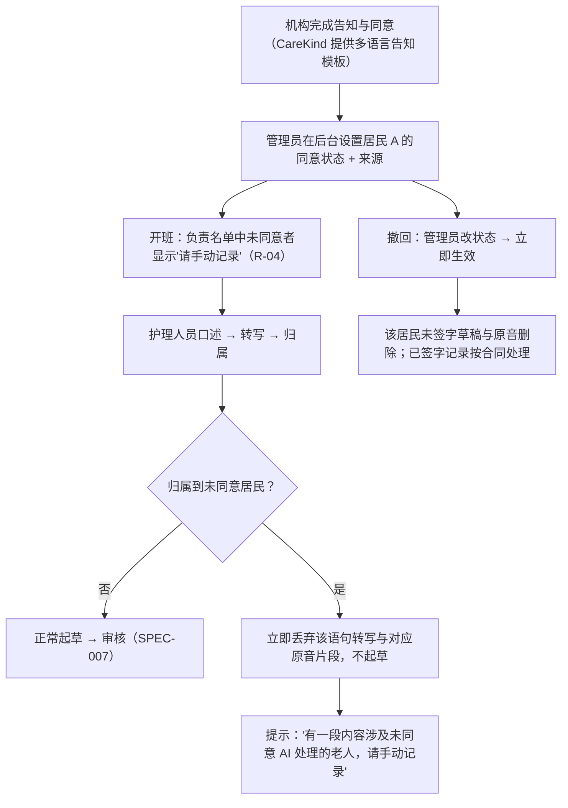

# 居民同意管理 Consent Management

| 项 | 内容 |
|---|---|
| 文档 ID | SPEC-009 |
| 类型 | 功能 spec（P0）：居民级"AI 处理同意"状态 + 同意来源记录 + 撤回即生效 + 未同意居民的语句即时丢弃 |
| 版本 | v0.1 草稿 · 2026-10-19 |
| Owner | Terry（Product Owner + Tech Lead） |
| 状态 | 🟡 **待 Terry 审阅**（🛑 人工确认）；同意范围措辞与各州差异待律师确认 |
| 难度 | **L3**（[PRD 分配规范](../../11-rules/prd-assignment-rules.md) §2）：改变居民数据处理路径（`ai-pipeline` 归属后丢弃）+ 审计（`api`）+ `admin-web` + `mobile-app` |
| 关联 | [docs/PRD.md](../../../docs/PRD.md) B3 同意状态、C3 硬规则 5、C6 权限、D1、D8、E1 R-04、E6 M-02/M-04、F3；[录音同意指南](../../03-legal-compliance/recording-consent.md)；[审核签字 SPEC-007](2026-10-review-and-sign-off.md) |

> ⚠️ 本文中的法律判断为内部工作底稿，不构成法律意见。同意的**取得与保管由机构负责**（DPA 约定），CareKind 只记录机构录入的状态与来源，并按状态处理数据。本 spec 落实 PRD 已定边界（DR-004 按键口述；未同意老人不经 AI 处理），不改变产品边界。

## 1. 问题

- 生成式 AI scribe 一般需要知情同意，Ahpra 要求"explicit consent requirement as an initial step"；同意须可撤回，撤回后应停止处理并删除相关输出（ACSQHC）
- 很多居民有认知障碍，同意来自 registered supporter 或按州法确定的替代决策人；"谁同意、依据什么"必须可追溯
- 竞品空白：调研中**没有任何 aged care 产品**展示"居民级同意状态 + 替代决策人 + 未同意者不处理"的系统化做法，多数把同意推给机构或用户（[how-competitors-solve-it.md](../../07-marketing-operations/competitor-research/how-competitors-solve-it.md) §3 第 4 条、§4）
- 护士原话：访谈尚未开始，**不引用、不编造**

## 2. 目标与度量

| 目标 | 度量（对应 [PRD](../../../docs/PRD.md) G1 与 F2） | 目标值 |
|---|---|---|
| 未同意者不被 AI 处理 | 合成评测中涉及未同意居民的语句生成草稿的次数 | **0** |
| 撤回即生效 | 撤回操作到管线生效的时间 | 下一条语句起生效（目标 ≤ 60 秒） |
| 来源可追溯 | 有同意状态但缺来源类型的居民数 | 0（后台不允许保存） |
| 不拖慢班次 | 开班时同意提示的额外操作步数 | 0 步（只读提示，无需确认） |

## 3. 用户流程

## 4. 功能需求

| ID | 需求 | 优先级 |
|---|---|---|
| M-02 | 管理员按居民维护同意状态：`已同意` / `未同意` / `已撤回` / `未知`；**`未知` 一律按未同意处理**（安全默认） | P0 |
| M-02a | 每次设置必填来源类型：居民本人 / registered supporter 协助下的居民本人决定 / 州法替代决策人（如 NSW "person responsible"、enduring guardian）/ 其他（须文字说明）；以及适用辖区与依据、录入人、生效日期、机构保管的同意文件编号（CareKind 不存同意书原件） | P0 |
| M-02b | 状态变更全部写审计日志（M-04），历史可查不可删 | P0 |
| M-02c | DON 只读查看；护理人员只看到"请手动记录"提示，看不到同意来源细节（最小权限，C6） | P0 |
| R-04 | 开班时检查负责名单同意状态，未同意者显示"请手动记录"，不阻止开班 | P0 |
| C3-5 | 语句归属到未同意居民（含中置信建议）→ 立即丢弃该语句转写与对应原音片段，不生成草稿，只提示手动记录；丢弃事件只记元数据（时间、片段 ID），不记内容 | P0 |
| M-02d | 撤回立即生效：此后语句按 C3-5 处理；该居民**未签字**草稿与原音立即删除并留审计；**已签字**记录不改动，按合同处理 | P0 |
| M-02e | 名册导入时同意状态默认 `未知` | P0 |
| M-02f | 提供多语言、易读版告知模板（文案经律师确认后上线） | P1 |

## 5. 范围 / 不做什么

- ❌ 在产品内向居民或家属**收集**同意（电子签名、表单）——由机构线下完成并保管
- ❌ 判断居民是否具备决策能力；判断谁是合法替代决策人（机构依州法确定）
- ❌ 用声纹识别背景中的居民声音（A-06）
- ❌ 环境录音的同意体系（模式 C，需 DR-006）
- ❌ 限制性措施的同意（D-06，P2，另有州法 RPSDM 规则）

## 6. 失败与安全

| 情况 | 系统行为 |
|---|---|
| 同意服务不可用 | 管线按"全部未知 = 未同意"处理，不生成草稿，提示手动记录（fail safe） |
| 状态读取延迟 | 每条语句归属后实时查询，不使用开班时的缓存结果 |
| 语句未能归属（待归属） | 不起草；人工指定居民时再次检查同意状态 |
| 撤回时该居民有草稿在审核中 | 审核界面立即移除并提示原因 |

**建议 hazard**（编号待 Clinical Lead 分配，本 spec 不改 hazard log）：
- **未同意居民的内容被 AI 处理**（隐私违规）→ 缓解：未知 = 未同意；实时查询；评测为 0
- **丢弃后护理人员未手动补记**，记录缺失 → 缓解：明确提示并计入本班"待办"；培训强调

## 7. 法律依据 Legal References

> 查阅日期：2026-10-19 ｜ 依据 [法律参考索引](../../11-rules/legal-reference-index.md) ｜ ⚠️ 内部工作底稿，非法律意见

| 话题 | 本地文件（章节） | 对设计的影响 |
|---|---|---|
| 录音与居民同意 | [recording-consent.md](../../03-legal-compliance/recording-consent.md)（居民同意、DR-004） | 按键口述；认知障碍居民按支持决策人安排；可随时撤回；同意记录由客户保管（M-02a、M-02d） |
| 各州录音法 | [state-by-state-comparison.md](../../03-legal-compliance/research/state-by-state-comparison.md) §2、§10 第 1 条 | NSW、WA、SA、TAS、ACT 一般需全体当事人同意；背景声音风险 → 离开房间后口述提示；同意状态不能替代录音法合规 |
| 五辖区深度核查（QLD、WA、SA、TAS、NT） | [state-deep-dive-qld-wa-sa-tas-nt.md](../../03-legal-compliance/research/state-deep-dive-qld-wa-sa-tas-nt.md) §0 第 1–3 条、§6、§7 | 独自口述一般不构成"私人对话"（需律师确认）→ 支持模式 A；QLD s45、NT s15 限制录音传播 → 居民同意须覆盖"上传转写、供其他员工阅读"；WA、SA、TAS 需全体当事人同意；同意来源须带"辖区 + 依据"（M-02a） |
| 监护与替代决策 | [state-by-state-comparison.md](../../03-legal-compliance/research/state-by-state-comparison.md) §4、§10 第 6 条 | 来源类型须区分居民本人 / supporter / 州法替代决策人（M-02a） |
| 州健康隐私法 | [state-by-state-comparison.md](../../03-legal-compliance/research/state-by-state-comparison.md) §1；[privacy-program.md](../../03-legal-compliance/privacy-program.md) §3（APP 3、5、6、11） | NSW HRIP、VIC HRA、ACT HRPA 直接约束 CareKind；敏感信息收集需同意；不再需要即删除（C3-5、M-02d） |
| AI 使用同意与撤回 | [federal-law-summary.md](../../03-legal-compliance/research/federal-law-summary.md) §4（Ahpra）、§5（ACSQHC）；[aged-care-documentation-workflows.md](../../03-legal-compliance/research/aged-care-documentation-workflows.md) §12 第 5、6 条、§11 第 16 条 | 首步明确同意；撤回停止处理并删除输出；同意状态由机构录入、CareKind 只读执行 |
| 文档归属 | [aged-care-paperwork-checklist.md](../../03-legal-compliance/research/aged-care-paperwork-checklist.md) §1（"AI 处理 / 录音同意"行） | 同意文件由机构取得与保管；CareKind ❌ 不起草 |
| 居民权利 | [aged-care-alignment.md](../../03-legal-compliance/aged-care-alignment.md)；[federal-law-summary.md](../../03-legal-compliance/research/federal-law-summary.md) §1.2、§1.3 | 尊重居民选择；拒绝 AI 处理不影响其照护（手动记录路径） |
| TGA | [tga-samd-assessment.md](../../03-legal-compliance/tga-samd-assessment.md) | 同意管理不涉及临床功能，非器械 |
| 三辖区深度核查（NSW、VIC、ACT） | [state-deep-dive-nsw-vic-act.md](../../03-legal-compliance/research/state-deep-dive-nsw-vic-act.md) | VIC s11 限制传播 → 同意须覆盖转写与供员工阅读；机构员工不能作为默认替代决策人（NSW、VIC、ACT）；ACT 口头 health direction 只忠实记录并提示护士处理，不判断有效性；居民无能力时谁可代为同意录音须律师确认 |

**需律师确认**：(1) "先转写再识别、识别后即丢弃"是否构成对未同意居民健康信息的"收集"，以及 DPA 与告知材料的如实措辞（PRD C3 硬规则 5）；(2) 背景中被录到的未同意居民或他人声音，在 NSW、WA、SA、TAS、ACT 的刑事风险；(3) 各州哪些替代决策人有权就"AI 处理记录"作出同意；(4) 撤回后已签字记录在 CareKind 侧的处理（删除或保留至转入机构系统）。
**合规检查**：未运行 —— 定稿前运行 skill `compliance-check`（L-7）；需更新 PIA（`pia/PIA-2026-001.md`）。

## 8. 检查清单

- [x] 法律依据已填写，`check_rules.py` 通过
- [x] TGA 判定：是否生成诊断 / 治疗 / 用药建议？**否**
- [ ] 临床 hazard：§6 建议项，待 Clinical Lead 审阅后由人加入
- [ ] 隐私：新数据类型 = 同意状态与来源元数据 → 纳入 PIA
- [x] 新子处理方 / 新模型：无
- [ ] 可访问性与多语言：告知模板多语言、易读版（M-02f，P1）

## 9. 评测计划（合成数据）

| 评测 | 方法 | 通过标准 |
|---|---|---|
| 未同意丢弃 | 合成名册中居民 A 未同意、居民 B 已同意；合成口述混合提及两人（含同名、只用房号、代词） | 居民 A 相关语句草稿数 = 0；转写与原音片段被删除 |
| 未知默认 | 新导入名册不设状态 | 全部按未同意处理 |
| 撤回 | 班中撤回居民 B | 撤回后语句不起草；未签字草稿删除；已签字记录不变；审计完整 |
| 故障 | 模拟同意服务超时 | 不生成任何草稿（fail safe） |
| 权限 | PCW 账号查看同意来源 | 被拒绝 |
