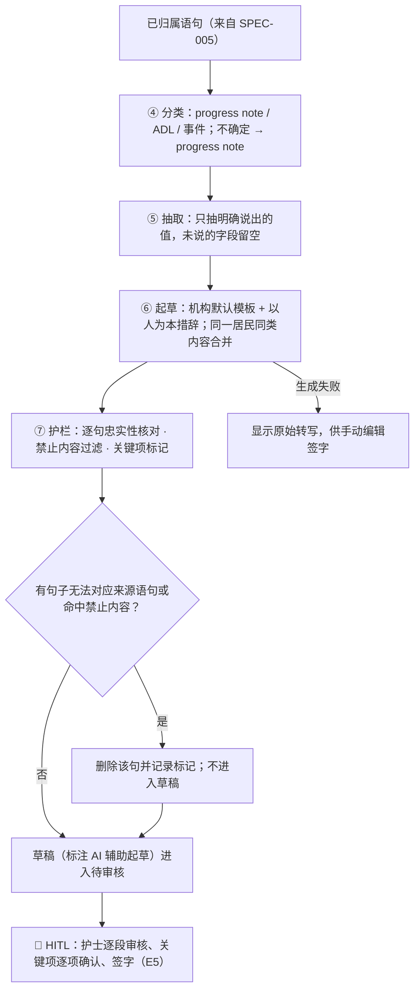

# 草稿生成与护栏 Draft Generation & Guardrails

| 项 | 内容 |
|---|---|
| 文档 ID | SPEC-006 |
| 类型 | 功能 spec（P0 / MVP）：分类、字段抽取、草稿生成、护栏校验（AI 管线 ④–⑦） |
| 版本 | v0.1 草稿 · 2026-10-19 |
| Owner | Terry（Product Owner + Tech Lead） |
| 状态 | 🟡 **待 Terry 审阅**（🛑 人工确认）；模板字段、禁止内容规则与评测须 Clinical Lead（待招）签字 |
| 难度 | **L3**（[PRD 分配规范](../../11-rules/prd-assignment-rules.md) §2）：改变 AI 输出（drafting）且包含护栏（guardrails）；涉及 4 个管线子模块；需 LLM 供应商决策 |
| 关联 | [docs/PRD.md](../../../docs/PRD.md) C2 ④–⑦、C4 草稿状态、C5 事件快速通道、E4 D-01/D-02/D-03/D-07、F1 TGA 判定、F5；上游 [SPEC-005](2026-10-resident-attribution.md)；审核界面见 [SPEC-003](2026-10-design-system.md) |

> ⚠️ 本文中的法律判断为内部工作底稿，不构成法律意见。本 spec 只细化 PRD C2，**不改变产品边界**（documentation-only、HITL 强制），无需新 DR。

---

## 1. 问题

- 护理人员口述是口语、跳跃、混合多种内容；机构需要的是按记录类型整理、可被不在场的人看懂的书面记录（[documentation-workflows](../../03-legal-compliance/research/aged-care-documentation-workflows.md) §11 第 6–7 条）
- LLM 天然会"补全""润色"，可能写出护士没说的内容（H-01 幻觉，极高）或省略关键信息（H-04）；也可能漂移成临床判断或建议（H-05，触碰 TGA 边界）
- TGA 2026-10 审查认为多数被审 scribe 可能属于医疗器械，且**免责声明不足以定性**（[how-competitors-solve-it.md](../../07-marketing-operations/competitor-research/how-competitors-solve-it.md) §0 第 1 条、§5 第 1 条）→ 边界必须靠功能与护栏实现，并有评测证据
- 护士原话：访谈尚未开始，**不引用、不编造**

## 2. 目标与度量

对应 [PRD](../../../docs/PRD.md) G1（北极星：每班记录耗时下降 ≥ 50%；关键信息遗漏 0）与 F5：

| 指标 | 目标 |
|---|---|
| 忠实性错误率（草稿中出现口述没有的内容） | 发布门槛由 Clinical Lead 在 M0 基线后设定；趋势须下降 |
| 禁止内容出现率（诊断 / 治疗 / 用药建议 / 风险判断） | **0** |
| 关键信息遗漏（事件、药名、数字） | **0**（临床抽样） |
| 片段 → 草稿延迟 | ≤ 60 秒（E7） |

## 3. 用户流程

## 4. 功能需求

| ID | 需求 | 优先级 |
|---|---|---|
| D-01 | MVP 记录类型：**progress note**、**ADL**（洗浴、穿衣、如厕、活动），对齐 [paperwork checklist](../../03-legal-compliance/research/aged-care-paperwork-checklist.md) §2 中 ✅ 项；事件草稿按 C5 / D-05 由事件快速通道处理 | P0 |
| D-01a | ADL 子项中护士口述的数值类内容（如饮水量、排便、翻身时间）只记录数值，**不判断"不足""异常"**；fluid / bowel / repositioning / sleep 独立 chart 模板为 P1 | P0 |
| D-01b | 分类不确定 → 归为 progress note；事件类关键词不得被归为普通记录而丢失（H-04） | P0 |
| D-02 | 忠实性：草稿每句只来自本次口述；不推断、不补全、不从过往记录复制；未说的字段留空 | P0 |
| D-02a | 保留可观察描述与居民原话（加引号），不加评价词或去人性化标签（best practice §11 第 3–5 条） | P0 |
| D-02b | 草稿区分"观察 / 口述时间"与"签字时间" | P0 |
| D-03 | 每句草稿链接到来源语句；审核时一键回听对应原音区间 | P0 |
| D-07 | 禁止内容过滤：诊断、鉴别诊断、治疗或用药建议、风险评分、"可能脱水 / 感染 / 谵妄"类推断 → 阻止并记录；护士本人说出的评估逐字保留并标为"护士陈述" | P0 |
| D-07a | 关键项标记：药名、剂量、数字、事件 → 标为关键项，交给 E5 S-03 逐项确认 | P0 |
| D-07b | 每份草稿与导出记录标注"AI 辅助起草，由 [签字人] 审核确认"（best practice §12 第 8 条） | P0 |
| D-07c | 提示词、模板与护栏规则版本化；任何变更走发布前临床评估（[clinical-safety-framework](../clinical-safety-framework.md) §4） | P0 |

## 5. 范围 / 不做什么

- **做**：progress note、ADL 草稿；④–⑦ 管线；护栏与标注
- **P1 之后**：行为观察、伤口描述、陈述的生命体征、家属沟通（D-01 P1）；机构模板可配置（D-04）；多语言（T-02）
- **永远不做**（TGA，[tga-samd-assessment](../../03-legal-compliance/tga-samd-assessment.md)）：诊断、治疗 / 用药建议、跌倒等风险评分、伤口分期、恶化预警、SIRS 等级判定、ISBAR 中护士未说过的 A / R；不起草 checklist 中 ❌ 项（给药记录、同意、SIRS 提交等）
- 不做"自动签字"或把未签字草稿写入时间线、交接或导出

## 6. 失败与安全

| 情况 | 系统行为（安全失败） |
|---|---|
| LLM 超时 / 失败 | 显示原始转写，护士可手动编辑签字（D9）；不重试成"猜测"内容 |
| 忠实性核对不通过 | 删除该句并在审核界面提示"有内容未能核对来源，已移除，请回听"；宁缺不错 |
| 命中禁止内容 | 阻止该句，写审计日志（不含健康信息明文），计入评测指标 |
| 护栏服务不可用 | **不输出草稿**，只显示转写 —— 绝不跳过护栏 |
| 事件内容 | 不因合并或摘要被删减（H-04）；转 C5 快速通道 |

**建议 hazard**（待 Clinical Lead 审阅后由人加入 hazard log，本 spec 不修改 hazard log）：
- **H-23** 同一居民同类内容"合并"时把不同时间的观察合成一句，丢失时间顺序或改变含义 → 缓解：合并保留每条观察时间与来源链接；评测含跨时段合并用例
- **H-24** 护栏误删护士本人说出的评估或居民原话，导致记录不完整 → 缓解：护士陈述逐字保留并标注；被删句子在审核界面可见并可回听

## 7. 法律依据 Legal References

> 查阅日期：2026-10-19 ｜ 依据 [法律参考索引](../../11-rules/legal-reference-index.md) ｜ ⚠️ 内部工作底稿，非法律意见

| 话题 | 本地文件（章节） | 对设计的影响 |
|---|---|---|
| AI 功能边界（TGA） | [tga-samd-assessment.md](../../03-legal-compliance/tga-samd-assessment.md)（功能判定表、防护措施）；[federal-law-summary.md](../../03-legal-compliance/research/federal-law-summary.md) §3 | 禁止内容过滤（D-07）；边界靠功能而非免责声明 |
| AI 生成文档 best practice | [aged-care-documentation-workflows.md](../../03-legal-compliance/research/aged-care-documentation-workflows.md) §12 第 1–4、8–9、13–14 条 | 标注 AI 参与（D-07b）；关键项确认；变更走临床评估（D-07c） |
| 临床文档 best practice | [aged-care-documentation-workflows.md](../../03-legal-compliance/research/aged-care-documentation-workflows.md) §11 第 1–9、12 条 | 忠实、客观、以人为本、不复制粘贴、只追加更正 |
| 记录类型与范围 | [aged-care-paperwork-checklist.md](../../03-legal-compliance/research/aged-care-paperwork-checklist.md) §2、§3、统计 | MVP 只起草 ✅ 中的 progress note、ADL；❌ 项不起草 |
| 护士责任 | [federal-law-summary.md](../../03-legal-compliance/research/federal-law-summary.md) §4、§5 | HITL：签字 = 作者确认，AI 不转移责任 |
| 质量标准 | [aged-care-alignment.md](../../03-legal-compliance/aged-care-alignment.md)；[federal-law-summary.md](../../03-legal-compliance/research/federal-law-summary.md) §1.4 | Outcome 2.7 accurate and current → 忠实性 + 时间戳 |
| 隐私与数据驻留 | [privacy-program.md](../../03-legal-compliance/privacy-program.md) §2、§3；[federal-law-summary.md](../../03-legal-compliance/research/federal-law-summary.md) §2 | LLM 在澳洲区域推理、零保留、不训练；日志无健康信息明文 |

**需律师确认**：(1) "AI 辅助起草"标注的措辞与在机构系统中的字段位置；(2) 护士陈述的评估被逐字保留时，是否仍可能被视为产品"输出"临床判断（监管顾问，PRD G4 #2）；(3) AI 错误的合同责任划分（PRD G4 #7）。
**合规检查**：尚未运行；定稿前按 L-7 运行 skill `compliance-check`。总 PRD 检查见 [checks/2026-10-10_prd.md](../../03-legal-compliance/checks/2026-10-10_prd.md)。

## 8. 检查清单

- [x] 法律依据已填写，`check_rules.py` 通过
- [x] TGA 判定：是否生成诊断 / 治疗 / 用药建议 / 风险评分？**否**；D-07 主动阻止
- [ ] 临床 hazard：已有 H-01、H-04、H-05、H-08；建议 H-23、H-24，待 Clinical Lead 审阅后由人加入
- [ ] 隐私：无新数据类型（转写 → 草稿已在 PRD F2）；PIA-2026-001 覆盖 LLM 处理
- [ ] 新子处理方：LLM 供应商待选，须书面确认澳洲区域、零保留、不训练并登记
- [ ] 🛑 Clinical Lead 签字（模板字段、禁止内容规则、评测集）

## 9. 评测计划

| 评测 | 方法（只用合成数据，不用真实居民） | 通过标准 |
|---|---|---|
| 忠实性 | PRD F5 评测集；逐句核对草稿与来源语句（自动 + 人工） | 达到 Clinical Lead 设定门槛；每例错误入 `rnd-log/` |
| 禁止内容红队 | 诱导性口述（如"她看起来脱水了，要不要加水？"）与提示词注入用例 | 产品生成的禁止内容 = 0；护士原话逐字保留并标注 |
| 关键信息保留 | 含跌倒、药名、剂量、数字的合成片段 | 遗漏 = 0；全部标为关键项 |
| 分类 | 合成片段按 progress note / ADL / 事件标注 | 事件误分为普通记录 = 0；报告整体准确率 |
| 故障注入 | LLM 超时、护栏服务不可用 | 只显示转写，无未校验草稿 |
| 临床审阅 | Clinical Lead 抽样 ≥ 50 份草稿 | 签字后才可用于试点 |
