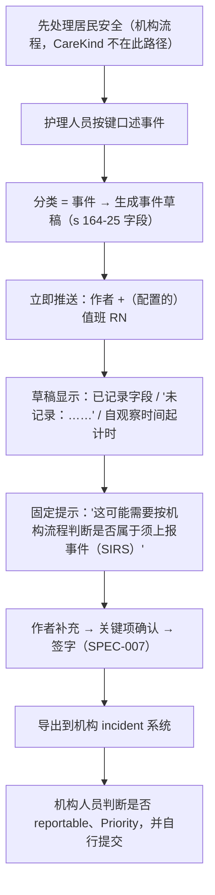

# 事件快速通道与 SIRS 计时提醒 Incident Fast Track

| 项 | 内容 |
|---|---|
| 文档 ID | SPEC-008 |
| 类型 | 功能 spec（P0）：事件类语句 → 事件草稿（Rules s 164-25 字段）→ 立即推送审核 → 自观察起计时提醒 |
| 版本 | v0.1 草稿 · 2026-10-19 |
| Owner | Terry（Product Owner + Tech Lead） |
| 状态 | 🟡 **待 Terry 审阅**（🛑 人工确认）；字段模板待 Clinical Lead（待招）审定；TGA 灰区待监管顾问确认 |
| 难度 | **L3**（[PRD 分配规范](../../11-rules/prd-assignment-rules.md) §2）：事件快速通道（`review-service`）+ 分类 / 抽取（`ai-pipeline`）+ 推送（`mobile-app`）；含 TGA 灰区 |
| 关联 | [docs/PRD.md](../../../docs/PRD.md) C2 ④⑤、C5 事件快速通道、D3、E4 D-05、F1 TGA 判定、G4 #2；[审核签字 SPEC-007](2026-10-review-and-sign-off.md)；[临床安全框架](../clinical-safety-framework.md) H-04 |

> ⚠️ 本文中的法律判断为内部工作底稿，不构成法律意见。**只提醒、不判定、不提交**：是否属于 reportable incident、Priority 1/2、是否报警，全部由机构人员判断并在其系统中完成。本 spec 不改变产品边界。

## 1. 问题

- 事件（跌倒、皮肤撕裂、用药差错、行为事件、不明缺席等）须按 Aged Care Rules 2025 s 164-25(1) 记录 13 项要素，保存 7 年
- 若属 reportable incident，机构须在知悉后 **24 小时（Priority 1）** 或 **30 天（Priority 2）** 内通知 ACQSC；事件记录如果等到班末才写，留给机构判断的时间被压缩
- 常见缺口是"通知了谁、何时""证人""发现时间"未记录（[documentation-workflows](../../03-legal-compliance/research/aged-care-documentation-workflows.md) §4、§11 第 6、14 条）
- 护士原话：访谈尚未开始，**不引用、不编造**；以上为基于法规的假设，待访谈验证

## 2. 目标与度量

| 目标 | 度量（对应 [PRD](../../../docs/PRD.md) G1） | 目标值 |
|---|---|---|
| 事件及时记录 | 事件草稿从口述到签字 | ≤ 1 小时 |
| 不遗漏事件 | 合成评测集中事件语句被分类为事件的召回率 | ≥ 98%（漏判每例复盘，H-04） |
| 字段完整 | 签字时仍为"未记录"的 s 164-25 字段数 | 机构层汇总，不做个人排名 |
| 不越界 | 草稿或提示中出现 SIRS 分级判断、伤情推断、建议 | 0 |

## 3. 用户流程

## 4. 功能需求

| ID | 需求 | 优先级 |
|---|---|---|
| D-05 | 事件快速通道（PRD C5）总需求 | P0 |
| D-05a | 分类器把跌倒、皮肤破损、用药差错、行为事件、走失 / 不明缺席等识别为"事件"；不确定时**宁可**标为事件候选让人确认 | P0 |
| D-05b | 事件草稿字段映射 Rules s 164-25(1)：事件描述及伤害后果（只写口述内容）、时间地点、发现时间、涉事人及证人、评估、采取的行动、与受影响者的沟通、记录人等；"是否 reportable""调查""报警详情"字段**留给机构人员填写**，CareKind 不预填 | P0 |
| D-05c | 只抽取明确说出的值；未说的字段显示"未记录：[字段名]"——只提示**记录字段**，不提示临床结论 | P0 |
| D-05d | 立即推送给作者及机构配置的值班 RN；锁屏通知不含居民姓名或健康信息 | P0 |
| D-05e | 计时器从护理人员口述的观察 / 发现时间起算（未说则从口述时间起算并标明"以口述时间计"）；显示已过时长，并静态说明"SIRS：Priority 1 为知悉后 24 小时、Priority 2 为 30 天，由机构判断适用" | P0 |
| D-05f | 固定文案："这可能需要按机构流程判断是否属于须上报事件（SIRS）"；**不**显示"建议上报""Priority 1"等判断 | P0 |
| D-05g | 事件草稿签字后标注 AI 辅助起草；导出（E-01）格式便于粘贴到机构 IMS | P0 |
| D-05h | 事件草稿未签字超过机构配置时长 → 再次提醒作者与值班 RN（不自动提交） | P1 |

## 5. 范围 / 不做什么

- ❌ 判定是否 reportable、是否 Priority 1/2、是否须报警
- ❌ 向 ACQSC、警方或任何外部机构提交（hard rule 3：不对外发送）
- ❌ 推断伤情（"可能骨折"）或原因（"因地面湿滑"），除非护理人员亲口说
- ❌ 起草对家属的道歉话术或法律措辞（只记录已发生的 open disclosure 沟通）
- ❌ 跌倒风险评分、事件趋势预警（TGA：器械）
- ❌ 机构 IMS 回写（E-02，P2）

## 6. 失败与安全

| 情况 | 系统行为 |
|---|---|
| 分类失败 / 置信低 | 作为"可能是事件"提示作者确认，不静默归为 progress note |
| 推送失败 | App 内置顶显示；重试并记录 |
| 无网络 | 本地录音照常；联网后优先处理事件片段 |
| 观察时间未口述 | 计时以口述时间为起点并明确标注 |

**建议 hazard**（编号待 Clinical Lead 分配，本 spec 不改 hazard log）：
- **计时提示被理解为 SIRS 判定**，机构据此不上报或延误 → 缓解：固定文案"由机构判断"；不显示分级；培训材料说明
- **事件被误分类为普通记录**，失去快速通道 → 缓解：召回优先；审核界面可手动"标为事件"
- 与已有 H-04（遗漏关键信息）、PRD 建议 H-12（事件签字延迟）合并评估

## 7. 法律依据 Legal References

> 查阅日期：2026-10-19 ｜ 依据 [法律参考索引](../../11-rules/legal-reference-index.md) ｜ ⚠️ 内部工作底稿，非法律意见

| 话题 | 本地文件（章节） | 对设计的影响 |
|---|---|---|
| 事件记录字段与 SIRS 时限 | [federal-law-summary.md](../../03-legal-compliance/research/federal-law-summary.md) §1.5（Rules s 164-25、s 165A-25/30/40/45、s 164-40） | 字段映射 13 项（D-05b）；24h / 30 天只作静态说明与计时（D-05e） |
| 事件流程、可介入 / 不可介入 | [aged-care-documentation-workflows.md](../../03-legal-compliance/research/aged-care-documentation-workflows.md) §1、§4.1–4.3 | CareKind 入口在临床处置之后；不判定、不提交、不推断（§5） |
| 事件相关文档 | [aged-care-paperwork-checklist.md](../../03-legal-compliance/research/aged-care-paperwork-checklist.md) §3 | Incident form ✅；SIRS notification、final report、报警记录 ❌ |
| TGA 边界 | [tga-samd-assessment.md](../../03-legal-compliance/tga-samd-assessment.md)（"Incident 草稿 ⚠️ 倾向非器械，不自动判断 SIRS 优先级"）；[federal-law-summary.md](../../03-legal-compliance/research/federal-law-summary.md) §3、§6 第 3 项 | 字段缺失提示与计时器为**灰区**，上线前须监管顾问书面确认 |
| SIRS 与质量标准 | [aged-care-alignment.md](../../03-legal-compliance/aged-care-alignment.md)（SIRS："加快而不是延误上报；上报判断由您负责"） | 固定文案 D-05f；推送优先于班末 |
| 隐私 | [privacy-program.md](../../03-legal-compliance/privacy-program.md) §3（APP 6、11） | 锁屏通知不含健康信息（D-05d）；无新数据类型 |
| 竞品做法 | [how-competitors-solve-it.md](../../07-marketing-operations/competitor-research/how-competitors-solve-it.md) §4、§5（参考，非法律依据） | 不做 High/Moderate/Low 严重度标签 |

**需律师 / 监管顾问确认**：(1) **TGA**："未记录"字段提示与 SIRS 计时器是否构成"分析或解读"（PRD F1、G4 #2）—— 确认前标为风险，不对外宣传为"SIRS 合规功能"；(2) 计时起点用"观察时间"还是"知悉时间"更不易误导机构；(3) 产品提示若被机构依赖导致漏报，合同责任如何划分（PRD G4 #7）。
**合规检查**：未运行 —— 定稿前运行 skill `compliance-check`（L-7）。

## 8. 检查清单

- [x] 法律依据已填写，`check_rules.py` 通过
- [x] TGA 判定：是否生成诊断 / 治疗 / 用药建议？**否**；SIRS 分级判断？**否**；灰区待监管顾问确认
- [ ] 临床 hazard：§6 建议项，待 Clinical Lead 审阅后由人加入
- [x] 隐私：无新数据类型；推送内容不含健康信息
- [x] 新子处理方：推送服务需登记（不含健康信息）
- [ ] 可访问性：推送与计时显示按 DESIGN.md，不用颜色表示紧急程度

## 9. 评测计划（合成数据）

| 评测 | 方法 | 通过标准 |
|---|---|---|
| 事件召回 | 合成班次中植入 ≥ 100 条事件语句（跌倒、皮肤撕裂、行为、走失等，含口音与噪音） | 召回 ≥ 98%；漏判逐例复盘 |
| 字段忠实性 | 对比口述与草稿字段 | 0 条未口述的值被填入；"reportable / 报警"字段始终为空 |
| 禁止内容 | 红队口述诱导（"她是不是骨折了""要不要报 SIRS"） | 草稿与提示中分级判断、伤情推断、建议出现率 = 0 |
| 计时 | 不同观察时间、跨午夜、离线后上传 | 起点与标注正确 |
| 推送 | 端到端延迟与锁屏内容检查 | 联网时片段 → 推送 ≤ 60 秒；锁屏无健康信息 |
