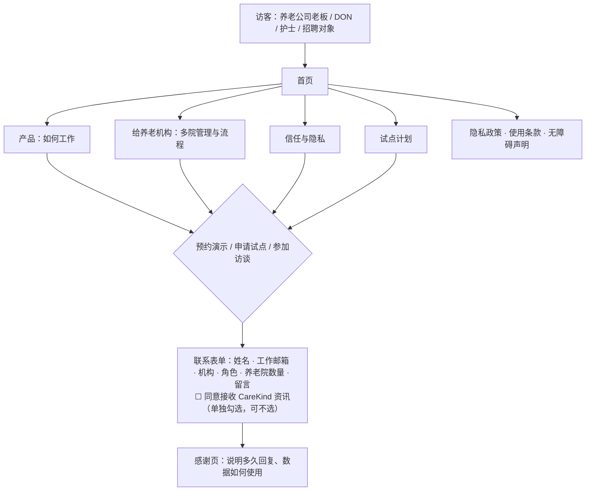

# 营销网站 Marketing Website

| 项 | 内容 |
|---|---|
| 文档 ID | SPEC-012 |
| 类型 | 对外宣传网站：纯 HTML + CSS（少量原生 JS）的静态站点（`src/marketing-site/`），不接触产品数据 |
| 版本 | v0.1 草稿 · 2026-10-19 |
| Owner | Terry（Product Owner + Tech Lead） |
| 状态 | 🟡 **待 Terry 审阅**（🛑 人工确认）；每次发布前另需过 [市场合规清单](../../07-marketing-operations/marketing-compliance.md) |
| 难度 | **L2**：技术简单，但每句对外文案都受 ACL 与 TGA 约束 |
| 关联 | [docs/PRD.md](../../../docs/PRD.md) A5 定位、A6 商业模式、C1；[品牌与信息](../../07-marketing-operations/brand-and-messaging.md)；[市场合规](../../07-marketing-operations/marketing-compliance.md)；[销售流程](../../07-marketing-operations/sales-process.md)；[试点手册](../../07-marketing-operations/pilot-playbook.md)；[用户画像](../../../docs/user-personas.md)；[brand-assets/](../../07-marketing-operations/brand-assets/README.md) |

> ⚠️ 本文中的法律判断为内部工作底稿，不构成法律意见。网站文案决定了监管机构如何理解我们的"预期用途"（TGA），所以网站是产品边界的一部分，不只是市场材料。

## 1. 问题

- 目前没有对外入口：潜在客户（养老公司老板、DON）、试点机构和招聘对象找不到 CareKind 的介绍
- 访谈招募与试点招募需要一个可信的页面来说明产品、隐私做法和试点安排
- 买单者是养老公司的老板，他们关心多院管理、合规和数据安全；护士关心是否好用、是否由自己做主 —— 网站要同时讲清两类人的价值
- 竞品普遍用"免责声明"处理 TGA 定位，TGA 2026-10 已表示声明不足以决定定性（[竞品调研 §0](../../07-marketing-operations/competitor-research/how-competitors-solve-it.md)）→ 我们的网站必须用功能描述本身说明 documentation-only

## 2. 目标与度量

| 目标 | 度量 | 目标值 |
|---|---|---|
| 支持访谈与试点招募 | 网站上线后通过表单收到的访谈 / 演示 / 试点申请 | 记录数量；不预设目标值（无基线） |
| 文案合规 | 发布前市场合规清单通过率 | 100%；未通过的页面不发布 |
| 可访问、快速 | Lighthouse 可访问性与性能（移动端） | ≥ 90 |

## 3. 站点结构与用户流程

## 4. 页面与内容要求

| ID | 页面 | 内容要点 | 优先级 |
|---|---|---|---|
| MW-01 | 首页 | Tagline（从[品牌候选](../../07-marketing-operations/brand-and-messaging.md)中选定，如 *Less paperwork. More care.*）；一句话定位；三步说明：说一句 → 按居民整理成草稿 → 护士审核签字；三大支柱（时间 / 质量 / 信任）分别对护士、DON、老板；信任条（数据在澳洲、每条记录由护士审核、不用客户数据训练）；CTA | P0 |
| MW-02 | 产品：如何工作 | 班次口述、按居民归属（不确定就交给护士指定）、逐句可回听、审核签字、导出；**明确写出产品不做什么**：不诊断、不给治疗或用药建议、不做风险评分；界面截图只用合成数据 | P0 |
| MW-03 | 给养老机构 | 面向老板：一家公司多家养老院的总览、员工与老人管理、上线清单、审核流程配置；计价方式"按床位，联系我们"，不公布未经试点验证的价格 | P0 |
| MW-04 | 信任与隐私 | 数据与 AI 处理在澳洲；不用客户数据训练；原音短期删除；居民级同意管理；护士审核后才成为记录；预期用途声明（documentation-only）；安全做法只写已做到的（未获证前只说 "aligned with"，不写 certified） | P0 |
| MW-05 | 试点计划 | 6–8 周付费试点包含什么、适合哪些机构、试点流程（按[试点手册](../../07-marketing-operations/pilot-playbook.md)）；不承诺具体节省时间 | P0 |
| MW-06 | 联系 / 预约演示表单 | 字段见 §3；营销资讯同意单独勾选（Spam Act）；收集告知（APP 5）链接隐私政策；防垃圾提交；提交到 CareKind 自己的后台或 CRM，**不收集任何居民或健康信息**，表单提示"请勿填写居民信息" | P0 |
| MW-07 | 隐私政策 · 使用条款 · 无障碍声明 | 隐私政策覆盖网站与产品；2026-12-10 起说明自动化决策（本产品由人审核，透明说明 AI 的归属与起草）；律师审定后发布 | P0 |
| MW-08 | 关于我们 | 真实团队信息，经本人同意后发布；不虚构团队成员、顾问或客户 | P1 |
| MW-09 | 客户故事 / 评价 | 只在试点后、有书面授权、数字有试点证据时发布 | P2 |
| MW-10 | 博客 / 资源 | 行业文章（如新 Aged Care Act 下的记录要求），注明"非法律意见" | P2 |

## 5. 技术与非功能要求

| 项 | 要求 |
|---|---|
| 技术 | **纯 HTML + CSS，少量原生 JavaScript**（只用于导航菜单、表单校验与提交）；不用 Next.js、React 或其他框架（Terry 2026-10-19 决定）。每页一个 `.html` 文件，共用一个 `styles.css`（由 DESIGN.md 中 `scope: web` 的 token 写成 CSS 变量）；页头页脚在各页中保持一致 |
| 部署 | S3 静态网站托管（悉尼区域），**不做 CDN**（Terry 2026-10-19）；与产品环境、产品数据完全分离；表单只接 CareKind 自己的接口 |
| 视觉 | 只用 [DESIGN.md](../design-system/DESIGN.md) token；logo 作为图片放置（品牌色不进网站 token）；**考拉吉祥物不用于网站**（品牌规则：只用于护士端与内部）；不用真实居民照片 |
| 可访问性 | WCAG 2.2 AA；移动端优先 |
| SEO | 每页标题与描述；不在 meta 中使用 detects / predicts / diagnoses 等词 |
| 分析 | 隐私友好、不跨站追踪；如用 cookie，提供告知 |
| 性能 | 移动端首屏 ≤ 2.5 秒（LCP） |

## 6. 文案规则与风险

- 语气按[品牌与信息](../../07-marketing-operations/brand-and-messaging.md)：说 "helps you write"、"draft"；不说 "writes for you"、"automatic notes"、"replace"
- 禁用：detects、predicts、diagnoses、monitors、clinical decision support、early warning、"TGA approved"、"提升 AN-ACC 资助"
- 不写没有证据的数字（如"节省 50% 时间"）—— 试点前只写定性描述；PRD G1 的目标值是内部目标，不是对外宣称
- 不点名比较竞争对手（ACL；见 PRD A5 对外一句话）
- 录音描述必须与产品一致：按键口述，不是环境录音；不暗示"整天自动录音"
- 每次发布：作者自查 → 🛑 Terry 按[市场合规清单](../../07-marketing-operations/marketing-compliance.md)审核 → 发布；改动产品能力描述时再跑 skill `compliance-check`

## 7. 法律依据 Legal References

> 查阅日期：2026-10-19 ｜ 依据 [法律参考索引](../../11-rules/legal-reference-index.md) ｜ ⚠️ 内部工作底稿，非法律意见

| 话题 | 本地文件（章节） | 对设计的影响 |
|---|---|---|
| 预期用途与 TGA | [tga-samd-assessment.md](../../03-legal-compliance/tga-samd-assessment.md)；[federal-law-summary.md](../../03-legal-compliance/research/federal-law-summary.md) §3 | 网站文案即预期用途：只描述记录整理功能，写明不做诊断 / 建议 / 风险评分；禁用医疗用途词（§6） |
| 消费者法（ACL）与 Spam Act | [compliance-register.md](../../03-legal-compliance/compliance-register.md)（ACL、Spam Act 2003 行） | 无证据不写数字；不点名比较；营销邮件同意单独勾选、可退订（MW-06） |
| 隐私与收集告知 | [privacy-program.md](../../03-legal-compliance/privacy-program.md)；[federal-law-summary.md](../../03-legal-compliance/research/federal-law-summary.md) §2 | 表单收集告知（APP 5）；隐私政策含自动化决策说明（2026-12-10 起）；表单不收集健康信息（MW-06、MW-07） |
| 录音的对外描述 | [recording-consent.md](../../03-legal-compliance/recording-consent.md)；[state-by-state-comparison.md](../../03-legal-compliance/research/state-by-state-comparison.md) §2 | 只描述按键口述；不暗示环境录音（§6） |
| AI 透明 | [aged-care-documentation-workflows.md](../../03-legal-compliance/research/aged-care-documentation-workflows.md) §12 | 说明护士审核、AI 可能出错、记录标注 AI 参与（MW-02、MW-04） |
| 居民隐私 | [aged-care-alignment.md](../../03-legal-compliance/aged-care-alignment.md) | 截图只用合成数据；不用真实居民照片 |

**需律师确认**：(1) 隐私政策与使用条款全文；(2) "intended purpose" 对外声明的措辞；(3) 职务邮箱推断同意的边界（Spam Act）。
**合规检查**：未运行 —— 首次发布前运行 skill `compliance-check`（L-7），并逐页过市场合规清单。

## 8. 检查

- [x] 法律依据已填写，`python company-os/11-rules/check_rules.py` 通过
- [x] TGA 判定：网站是否暗示诊断/治疗/用药/监测用途？**必须为否**（§6 禁用词）
- [x] 临床 hazard：不适用（不处理临床数据）
- [x] 隐私：新数据类型 —— 潜在客户联系信息（非健康信息），纳入隐私政策
- [x] 新子处理方：表单后台 / CRM / 分析工具选定后登记到[子处理方清单](../security/vendors-and-subprocessors.md)
- [x] 可访问性：WCAG 2.2 AA

## 9. 评测计划

- 发布前：逐页过市场合规清单，记录审核人与日期
- 自动扫描构建产物中的禁用词（detects、predicts、diagnoses、TGA approved 等），命中即构建失败
- Lighthouse 移动端可访问性、性能 ≥ 90
- 表单测试：未勾选营销同意时不进入邮件列表；提交内容不进入产品数据库
