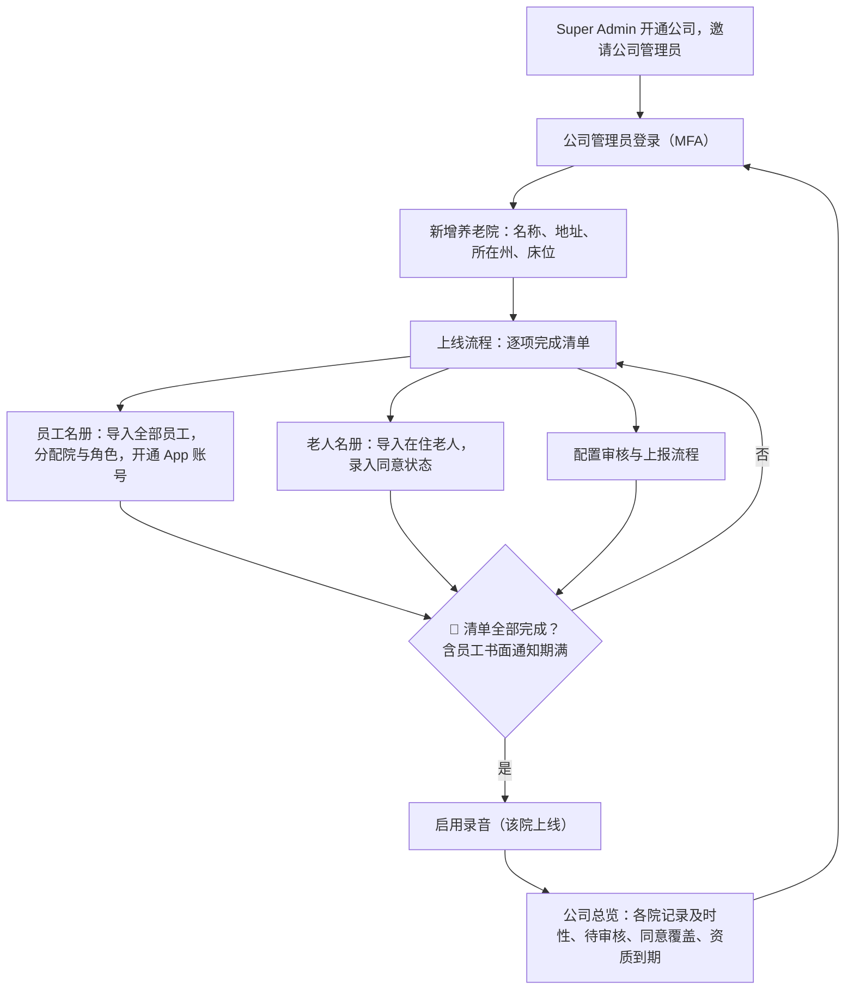
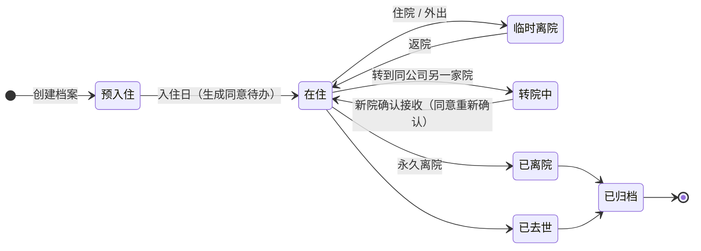
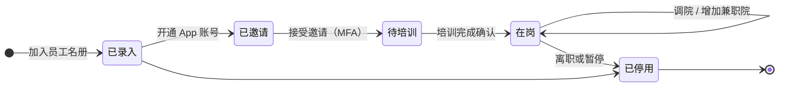

# 养老院管理端（公司 + 多家养老院）

| 项 | 内容 |
|---|---|
| 文档 ID | SPEC-011 |
| 类型 | 客户管理端：养老院 Web App 中按角色显示的管理功能（`src/admin-web/`） |
| 版本 | v0.1 草稿 · 2026-10-19 |
| Owner | Terry（Product Owner + Tech Lead） |
| 状态 | 🟡 **待 Terry 审阅**（🛑 人工确认） |
| 难度 | **L3**：多地点权限模型、居民生命周期影响 AI 归属范围、员工个人信息与资质数据 |
| 关联 | [docs/PRD.md](../../../docs/PRD.md) B2、B3、C1、C6、E6（PA-01–PA-06）；[SPEC-009 同意管理](2026-10-consent-management.md)；[SPEC-010 Super Admin](2026-10-super-admin-console.md)；[SPEC-008 事件快速通道](2026-10-incident-fast-track.md)；[上线清单模板](../../templates/paperwork/facility-go-live-checklist.md) |

> ⚠️ 本文中的法律判断为内部工作底稿，不构成法律意见。本 spec 不改变 TGA、录音模式、HITL、数据驻留边界。范围决定（Terry 2026-10-19）：买单的是养老公司的 business owner；一家公司可能有多家、多地点的养老院；第一阶段包含完整员工名册与四个流程（老人生命周期、员工生命周期、记录审核与上报、新养老院上线）。

## 1. 问题

- 客户是养老公司的老板或运营负责人，不是单个护士。他们需要在一个地方管理旗下所有养老院的员工、老人和上线进度，并看到各院记录工作是否跟得上
- 一家公司常有多家养老院，可能分布在不同州 → 适用的录音法、健康隐私法、员工通知要求按养老院所在州不同
- 员工会在同一公司的多家院之间调动或兼职；老人也可能在同公司的院之间转院
- 老人入住、转院、离院如果不及时反映到名册，AI 归属会以错误的名册为候选范围（放大 H-03 错误老人风险）
- 用户访谈尚未开始，不引用原话

## 2. 层级与角色

```
CareKind 平台（Super Admin，SPEC-010）
└── 公司 Organisation（租户，例：某养老集团）
	├── 养老院 Facility A（地点、所在州、床位）
	├── 养老院 Facility B
	└── …
```

| 角色 | 范围 | 主要工作 |
|---|---|---|
| 公司管理员（老板 / 运营负责人） | 整个公司 | 跨院总览；新增养老院；任命院长；公司级流程默认值；可进入任一院管理 |
| 院长 Facility Manager | 指定的一家或几家院 | 本院员工、老人、流程配置、上线清单 |
| DON / Clinical Care Manager | 指定院 | 审核与上报流程配置；查看本院记录（护士端权限） |
| 行政 / 质量经理 | 指定院 | 员工与老人名册维护、资质到期跟进 |
| RN / EN / PCW | 指定院 | 护士端（口述、审核、签字）；不进管理端 |
| 其他员工（厨房、清洁、行政等） | 指定院 | 只在员工名册中，无 App 账号（可选开通） |

规则：员工属于公司，可分配到一家或多家养老院；在每家院的角色可以不同。护士开班时只看到当前所在院的老人。

## 3. 用户流程



### 3.1 老人生命周期



- 只有"在住"的老人进入 AI 归属候选范围；"临时离院"保留在名册但标注，"已离院 / 已去世 / 已归档"立即退出候选范围
- 转院：老人档案转到新院，历史签字记录随档案保留只读；新院所在州不同时，提示按新州规则重新确认同意（SPEC-009）
- 已归档档案只读，按合同与保存期限处理，不删除

### 3.2 员工生命周期



- 未完成 CareKind 培训的员工不能录音（审核责任与 AI 局限的培训，PRD D1）
- 离职停用立即生效：退出登录、不能再签字；已签字记录保留

## 4. 功能需求

| ID | 需求 | 优先级 |
|---|---|---|
| PA-01 | 公司与养老院管理：公司资料；养老院列表与新增（名称、地址、所在州/领地、床位、时区）；养老院状态：配置中 / 已上线 / 已停用 | P0 |
| PA-01a | 角色范围：公司级（全部院）或院级（指定院）；服务端按 `organisation_id` 隔离租户，按 `facility_id` 限定院级权限 | P0 |
| PA-02 | 完整员工名册：姓名、职位、雇佣类型、所属院（可多个）、每院角色、是否开通 App；包含不使用 App 的员工；CSV 导入与单个编辑 | P0 |
| PA-02a | 资质与筛查记录：Ahpra 注册号与到期日（RN/EN）、工作人员筛查或警察核查到期日、CareKind 培训完成日；到期前 60 / 30 天提醒院长 —— **只提醒，不自动停用、不判断是否合规** | P0 |
| PA-02b | 员工生命周期（§3.2）：邀请、培训确认、调院、停用；所有变更写审计 | P0 |
| PA-03 | 老人名册与生命周期（§3.1）：入住、临时离院、转院（同公司内）、离院、去世、归档；状态变化实时更新 AI 归属候选范围 | P0 |
| PA-03a | 入住自动生成同意待办；同意未录入前该老人按"未同意"处理（SPEC-009） | P0 |
| PA-04 | 记录审核与上报流程（每院配置，公司可设默认值）：PCW 记录是否需 RN 复核及适用记录类型；未审核提醒时间与升级对象（值班 RN → DON）；事件草稿通知对象（SPEC-008）；签字记录转入机构系统的约定天数与负责人 | P0 |
| PA-05 | 新养老院上线流程：按[上线清单](../../templates/paperwork/facility-go-live-checklist.md)逐项勾选（合同、名册、同意、员工书面通知、培训、记录转入约定）；员工通知日期按所在州规则计算（如 NSW 提前 14 天）；🛑 全部完成前该院不能启用录音 | P0 |
| PA-06 | 公司总览（老板视角）：按养老院汇总 —— 记录及时率、待审核数、待归属比例、同意覆盖率、在岗员工数与 App 启用率、即将到期资质数、上线状态；点击进入单院 | P0 |
| PA-06a | 总览**只到养老院级**，不出现个人排名或个人效率指标（员工监控合规，PRD S-07）；不展示临床风险指标（TGA） | P0 |
| PA-07 | 管理端审计日志：员工、老人、同意、流程配置的每次变更 | P0 |
| PA-08 | 与机构现有 HR / 排班系统同步员工名册 | P2 |

## 5. 范围 / 不做什么

- 不做排班、考勤、工资、休假、绩效考核（不替代机构 HR 与护理管理系统，PRD A7）
- 不做培训课程内容（只记录培训完成）
- 不做老人账单、床位收费、AN-ACC 申报
- 不做临床指标看板（跌倒率、压伤率等 QI 统计）
- 公司管理员默认不在管理端看居民记录正文；如兼任临床角色，按护士端权限在所分配院查看
- 资质到期只提醒，是否允许该员工上岗由机构决定

## 6. 失败与安全

- 老人状态未及时更新 → 归属候选范围错误：离院/去世操作立即生效；护士端审核页始终显示第二标识；"临时离院"老人被提及时归为中置信
- 转院时历史记录不跟随新院员工权限扩散：新院员工只看到转院后的记录，旧院记录需院长授权查看【需 Clinical Lead 与律师确认】
- 员工停用即刻退出所有会话；共享设备上的未审核草稿转给值班 RN
- 建议新增 hazard（编号待 Clinical Lead 分配）：(1) 已离院或已去世老人仍在候选范围，记录归属到错误的人；(2) 同名老人分属同公司两家院，转院后归属混淆

## 7. 法律依据 Legal References

> 查阅日期：2026-10-19 ｜ 依据 [法律参考索引](../../11-rules/legal-reference-index.md) ｜ ⚠️ 内部工作底稿，非法律意见

| 话题 | 本地文件（章节） | 对设计的影响 |
|---|---|---|
| 员工个人信息（新数据类型） | [privacy-program.md](../../03-legal-compliance/privacy-program.md)；[federal-law-summary.md](../../03-legal-compliance/research/federal-law-summary.md) §2（APP 3、5、11） | 员工名册与资质记录纳入 PIA；只收集管理必需字段；员工收集告知 |
| 工作人员筛查与行为准则 | [federal-law-summary.md](../../03-legal-compliance/research/federal-law-summary.md) §1.11；[state-by-state-comparison.md](../../03-legal-compliance/research/state-by-state-comparison.md) §5 | 资质与筛查到期提醒（PA-02a）；只提醒不判定 |
| 多州养老院 | [state-deep-dive-nsw-vic-act.md](../../03-legal-compliance/research/state-deep-dive-nsw-vic-act.md)；[state-deep-dive-qld-wa-sa-tas-nt.md](../../03-legal-compliance/research/state-deep-dive-qld-wa-sa-tas-nt.md) | 每家院记录所在州（PA-01）；录音、隐私、员工通知规则按院所在州；跨州转院重新确认同意 |
| 员工监控 | [state-by-state-comparison.md](../../03-legal-compliance/research/state-by-state-comparison.md) §2；[staff-workplace-surveillance-notice.md](../../templates/paperwork/staff-workplace-surveillance-notice.md) | 上线前员工书面通知（PA-05）；总览不做个人排名（PA-06a） |
| 居民同意 | [recording-consent.md](../../03-legal-compliance/recording-consent.md)；[SPEC-009](2026-10-consent-management.md) | 入住生成同意待办；未录入按未同意处理（PA-03a） |
| 记录保存与离院 | [aged-care-paperwork-checklist.md](../../03-legal-compliance/research/aged-care-paperwork-checklist.md) §1、§6；[state-by-state-comparison.md](../../03-legal-compliance/research/state-by-state-comparison.md) §6 | 离院/去世归档只读，不删除 |
| 真实流程 | [aged-care-documentation-workflows.md](../../03-legal-compliance/research/aged-care-documentation-workflows.md) §2、§3、§9 | 入住、班次、离院流程与生命周期状态对应 |
| TGA | [tga-samd-assessment.md](../../03-legal-compliance/tga-samd-assessment.md) | 总览只展示记录运营指标，不展示临床风险指标 |

**需律师确认**：(1) 员工资质与筛查信息由 CareKind 托管的隐私义务与保存期；(2) 同公司内转院时，旧院记录对新院员工的可见范围；(3) 公司管理员跨院访问的告知要求。
**合规检查**：未运行 —— 定稿前运行 skill `compliance-check`（L-7）。

## 8. 检查

- [x] 法律依据已填写，`python company-os/11-rules/check_rules.py` 通过
- [x] TGA 判定：是否生成诊断/治疗/用药建议？**否**
- [ ] 临床 hazard：建议项见 §6，待 Clinical Lead
- [x] 隐私：**新数据类型 —— 员工个人信息与资质**，需更新 PIA
- [x] 新子处理方/新模型：无
- [x] 可访问性：WCAG 2.2 AA；UI 遵循 [DESIGN.md](../design-system/DESIGN.md)

## 9. 评测计划

- 合成公司：1 家公司 × 3 家养老院（2 个州），40 名员工（含多院兼职与非 App 员工），120 位老人（含同名、转院、离院案例）
- 权限测试：院级角色访问其他院数据全部拒绝；公司管理员可进入每一院；跨公司访问全部拒绝
- 生命周期测试：离院/去世后该老人不再出现在归属候选；转院后新院可归属、旧院不可归属
- 上线闸门测试：清单未完成或员工通知期未满时，该院录音按钮不可用
