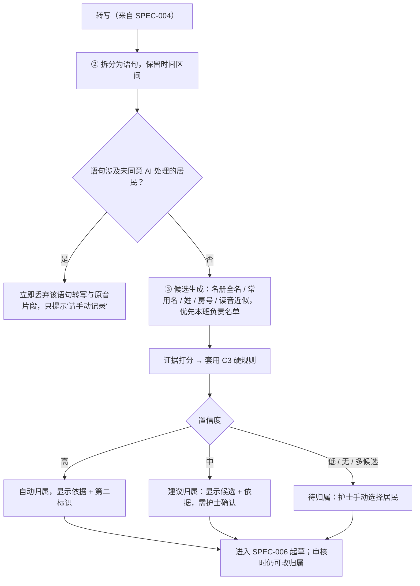

# 居民归属引擎 Resident Attribution Engine

| 项 | 内容 |
|---|---|
| 文档 ID | SPEC-005 |
| 类型 | 功能 spec（P0 / MVP）：语句拆分 + 语句 → 居民归属（AI 管线 ②③）；**最高风险模块** |
| 版本 | v0.1 草稿 · 2026-10-19 |
| Owner | Terry（Product Owner + Tech Lead） |
| 状态 | 🟡 **待 Terry 审阅**（🛑 人工确认）；硬规则与评测阈值须 Clinical Lead（待招）签字后才可用于试点 |
| 难度 | **L3**（[PRD 分配规范](../../11-rules/prd-assignment-rules.md) §2）：改变 AI 输出（归属）；hazard H-03/H-09 为极高风险；须临床评测与 Clinical Lead 签字 |
| 关联 | [docs/PRD.md](../../../docs/PRD.md) C2 ②③、**C3 归属引擎与硬规则**、C4 待归属、D2 步骤 8、E3 A-01~A-06、F4 H-09/H-10、G1；模块说明 [src/ai-pipeline/attribution/AGENTS.md](../src/ai-pipeline/attribution/AGENTS.md)；上游 [SPEC-004](2026-10-shift-voice-capture.md)，下游 [SPEC-006](2026-10-draft-generation-guardrails.md) |

> ⚠️ 本文中的法律判断为内部工作底稿，不构成法律意见。本 spec 只细化 PRD C3，**不放宽任何硬规则、不改变产品边界**（不用生物特征、未同意居民不经 AI 处理），无需新 DR。若将来想放宽 C3 任一条，须先写 DR。

---

## 1. 问题

- 模式 A 的价值在于"护士不必先选居民，只要自然地说出来"（PRD B4）。代价是：系统必须判断每句话说的是谁 —— 一旦放错档案，就是错误的临床记录（H-03/H-09，极高）
- 真实难点：同名或近似名居民、只说代词（"她还说膝盖疼"）、房号口误、一段话里提到多位居民、转写把姓名听错
- 竞品启示（[how-competitors-solve-it.md](../../07-marketing-operations/competitor-research/how-competitors-solve-it.md) §2 C1、§4）：德国 voize 已规模化"识别居民并分配记录"，证明机制可行；但其公开材料未说明不确定时如何处理。澳洲同类产品均为"先选对象或单条 note"。CareKind 的差异化是**"不确定就待归属"的保守策略**，宁可多让护士点一下，也不自动放错
- 护士原话：访谈尚未开始，**不引用、不编造**

## 2. 目标与度量

对应 [PRD](../../../docs/PRD.md) G1：

| 指标 | 目标 |
|---|---|
| **高置信误归属** | **0**（硬指标；任何一例都触发复盘与发布阻断） |
| 归属准确率（含护士确认后） | ≥ 98% |
| 未归属率（进入"待归属"） | ≤ 15%，**不以准确率为代价** —— 两者冲突时，优先保证误归属为 0 |
| 多居民片段的拆分准确率 | 基线在 M0 评测集测得后设定 |

## 3. 用户流程

## 4. 功能需求

| ID | 需求 | 优先级 |
|---|---|---|
| A-01 | 按全名、常用名、姓、房号 / 床号、读音近似与**本机构名册**匹配；候选优先本班负责名单 | P0 |
| A-02 | 一段话涉及多位居民时按句拆分，各句独立归属；无法拆分 → 整段进入待归属（H-10） | P0 |
| A-03 | 三级置信度；**只有高置信自动归属**，中 / 低置信不自动归属 | P0 |
| A-03a | 高置信须同时满足：唯一候选 **且**（两个标识一致，如姓名 + 房号；或名册中唯一的姓名且在本班负责名单内）（C3-1） | P0 |
| A-03b | 代词指代最多中置信，即使上一句已归属（C3-2） | P0 |
| A-03c | 名册中存在同名或近似名时，仅凭姓名永远不是高置信（C3-3） | P0 |
| A-03d | 姓名或房号所在词转写置信度低（T-03 标"[请确认]"）→ 不得为高置信 | P0 |
| A-03e | 阈值与硬规则集中在单一规则配置中定义并带版本号；每次修改走发布前临床评估（[clinical-safety-framework](../clinical-safety-framework.md) §4） | P0 |
| A-04 | 向审核界面输出归属依据（匹配了哪些标识）与**第二标识**（房号或照片），所有置信度级别都显示（C3-6） | P0 |
| A-04a | 未同意居民处理：识别后立即丢弃该语句转写与原音片段，不生成草稿，只提示"有一段内容涉及未同意 AI 处理的居民，请手动记录"；丢弃动作写审计日志（不含内容）（C3-5） | P0 |
| A-06 | 不使用声纹、人脸等生物特征（C3-4） | P0 |
| A-05 | 上下文延续作为中置信建议 | P1（不在本 MVP 范围） |

## 5. 范围 / 不做什么

- **做**：拆分、候选生成、规则 + 置信度分级、待归属队列数据、依据输出
- **不做**：生物特征识别；跨机构名册匹配；根据"居民通常怎样"推断归属（只用本句陈述的标识）；上下文延续（A-05，P1）；任何临床内容判断
- 审核界面交互（改归属、拆分、合并）属于 E5 S-01/S-02 与 [SPEC-003 Design System](2026-10-design-system.md)

## 6. 失败与安全

- **默认安全**：任何异常（名册不可用、规则配置加载失败、打分超时）→ 语句进入待归属，**绝不**降级为"按最可能的居民自动归属"
- 名册未同步或负责名单为空 → 本班全部语句不自动归属，并提示护士
- 审核界面始终显示第二标识；高置信也不能跳过签字前确认（H-03）
- 任何一例高置信误归属：记录为临床安全事件，按 [clinical-safety-framework](../clinical-safety-framework.md) §5 复盘，修复前冻结规则配置

**建议 hazard**（待 Clinical Lead 审阅后由人加入 hazard log，本 spec 不修改 hazard log）：
- **H-21** 名册过期（新入住、转房、离院未更新）使房号 + 姓名"两标识一致"指向错误居民 → 缓解：名册同步时间显示；房号变更后 N 天内该居民不以房号作高置信标识；评测含转房场景
- **H-22** 未同意居民因转写错误未被识别而进入 AI 处理 → 缓解：同意状态比对在归属前后各做一次；低置信姓名与未同意居民近音时一律丢弃并提示手动记录

## 7. 法律依据 Legal References

> 查阅日期：2026-10-19 ｜ 依据 [法律参考索引](../../11-rules/legal-reference-index.md) ｜ ⚠️ 内部工作底稿，非法律意见

| 话题 | 本地文件（章节） | 对设计的影响 |
|---|---|---|
| 居民身份准确 | [aged-care-documentation-workflows.md](../../03-legal-compliance/research/aged-care-documentation-workflows.md) §11 第 10 条（SQS 3.3.4(a)）；[aged-care-alignment.md](../../03-legal-compliance/aged-care-alignment.md) | 两要素识别；低置信不自动归属；第二标识（A-03a、A-04） |
| 未同意居民 | [recording-consent.md](../../03-legal-compliance/recording-consent.md)（居民同意）；[aged-care-documentation-workflows.md](../../03-legal-compliance/research/aged-care-documentation-workflows.md) §12 第 5–6 条 | 立即丢弃转写与原音（A-04a）；同意状态只读 |
| 隐私、敏感信息、生物特征 | [privacy-program.md](../../03-legal-compliance/privacy-program.md) §2、§3；[federal-law-summary.md](../../03-legal-compliance/research/federal-law-summary.md) §2 | 不采集声纹 / 人脸（A-06）；最小化处理；自动化决策透明说明 |
| 居民权利与尊严 | [federal-law-summary.md](../../03-legal-compliance/research/federal-law-summary.md) §1.2、§1.3 | 错误归属损害居民记录准确与隐私 → 保守策略 |
| AI 边界（TGA） | [tga-samd-assessment.md](../../03-legal-compliance/tga-samd-assessment.md)（功能判定表）；[federal-law-summary.md](../../03-legal-compliance/research/federal-law-summary.md) §3 | 归属只是"整理已陈述内容"，非器械；不得借归属信号推断临床状态 |
| 护士责任 | [federal-law-summary.md](../../03-legal-compliance/research/federal-law-summary.md) §4 | 归属由护士在签字时最终确认 |
| 州健康记录法 | [state-by-state-comparison.md](../../03-legal-compliance/research/state-by-state-comparison.md) §1 | 错误归属 = 向错误档案披露健康信息的风险，按数据泄露评估流程处理 |

**需律师确认**：(1) 未同意居民"先转写后丢弃"的处理在 APP 3 / NSW HRIP 下是否构成"收集"，以及 DPA 与告知材料的措辞（PRD C3-5）；(2) 一例错误归属已导出至机构系统时，是否构成 NDB 下的 eligible data breach（见 [data-breach-response-plan.md](../../03-legal-compliance/data-breach-response-plan.md)）；(3) 居民照片作第二标识的同意要求。
**合规检查**：尚未运行；定稿前按 L-7 运行 skill `compliance-check`。总 PRD 检查见 [checks/2026-10-10_prd.md](../../03-legal-compliance/checks/2026-10-10_prd.md)。

## 8. 检查清单

- [x] 法律依据已填写，`check_rules.py` 通过
- [x] TGA 判定：是否生成诊断 / 治疗 / 用药建议？**否**
- [x] 生物特征：**不使用**（A-06）
- [ ] 临床 hazard：已有 H-03、H-09、H-10；建议 H-21、H-22，待 Clinical Lead 审阅后由人加入
- [ ] 隐私：名册照片（可选）为新数据项，PIA-2026-001 须覆盖
- [ ] 新子处理方：若读音近似用第三方模型，须确认澳洲区域、不训练并登记
- [ ] 🛑 Clinical Lead 签字（硬规则与评测阈值）

## 9. 评测计划

| 评测 | 方法（只用合成名册与合成录音，不用真实居民） | 通过标准 |
|---|---|---|
| 硬规则单元测试 | 先写测试：同名、近似名、只有代词、房号口误、无候选 / 多候选、未同意居民、跨班次负责名单、转房 | 全部按 C3 硬规则输出 |
| 归属回归 | PRD F5 评测集（≥ 20 班次、≥ 800 片段；居民 A / 居民 B 式合成名册） | 高置信误归属 **0**；准确率 ≥ 98%；未归属率 ≤ 15% |
| 多居民拆分 | 一段话提到 2–3 位居民的合成片段 | 串写（H-10）= 0；无法拆分的进入待归属 |
| 未同意丢弃 | 含未同意居民的片段 | 无转写、原音、草稿残留；审计日志无内容 |
| 故障注入 | 名册服务不可用、规则配置损坏 | 全部进入待归属，无自动归属 |
| 临床审阅 | Clinical Lead 抽样 ≥ 50 份归属结果 | 签字；结果写入 `rnd-log/` |
