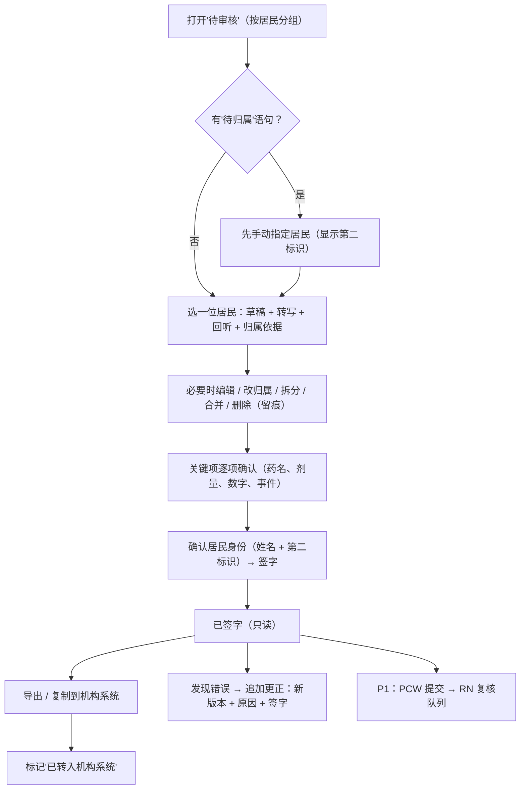

# 审核签字 Review & Sign-off（HITL）

| 项 | 内容 |
|---|---|
| 文档 ID | SPEC-007 |
| 类型 | 功能 spec（P0）：AI 草稿 → 护理人员审核 → 签字 → 只追加更正 → "已转入机构系统"确认 |
| 版本 | v0.1 草稿 · 2026-10-19 |
| Owner | Terry（Product Owner + Tech Lead） |
| 状态 | 🟡 **待 Terry 审阅**（🛑 人工确认）；临床部分待 Clinical Lead（待招）审阅 |
| 难度 | **L3**（[PRD 分配规范](../../11-rules/prd-assignment-rules.md) §2）：审核状态机 / HITL（`review-service`）+ 签字记录只追加（`record-store`）+ `mobile-app` |
| 关联 | [docs/PRD.md](../../../docs/PRD.md) C4 记录状态机、C6 权限、C7 数据与保留、D2 步骤 7–10、D4、E5 S-01~S-08；[临床安全框架](../clinical-safety-framework.md) H-01/H-02/H-03/H-08；[Design System](2026-10-design-system.md) §5.3；[核心 MVP spec](2026-10-shift-voice-to-resident-records.md) |

> ⚠️ 本文中的法律判断为内部工作底稿，不构成法律意见。本 spec 落实 PRD 已定的 HITL 边界，不改变产品边界，无需新 DR。

## 1. 问题

- AI 草稿只有经护理人员审核签字才能成为记录（Ahpra、ACSQHC：临床人员对最终记录负全部责任）。审核做得草率，H-01 幻觉、H-02 转写错误、H-03 关联错误居民都会直接进入正式记录
- 班末积压几十条草稿时，"整批一键通过"是最自然的捷径 → 自动化偏见（H-08、PRD 建议 H-11）
- MVP 没有回写机构系统（PRD C7）：签字记录如果没有被转入机构系统，机构就缺记录，CareKind 也不能删除
- 护士原话：用户访谈尚未开始（`08-feedback/raw/` 为空），**不引用、不编造**；以上为基于法规与调研的假设，待 30 次访谈验证

## 2. 目标与度量

| 目标 | 度量（对应 [PRD](../../../docs/PRD.md) G1） | 目标值 |
|---|---|---|
| 记录及时 | 常规记录签字时间 ≤ 班次结束 | ≥ 95% 试点记录（基线 M0 测得后确认） |
| 审核有效 | 关键信息遗漏（Clinical Lead 抽样） | 0 |
| 不误归属 | 签字后才发现的错误居民记录 | 0（每例复盘） |
| 不积压 | 下班时"未审核"条数 | 0 才算完成本班 |
| 转入机构系统 | 签字后超过约定天数仍未标"已转入"的记录 | 机构层面汇总展示，不做个人排名 |

## 3. 用户流程

## 4. 功能需求

| ID | 需求 | 优先级 |
|---|---|---|
| S-01 | 待审核按居民分组；每条草稿同屏显示草稿、转写、原音回听、归属依据与第二标识（照片或房号） | P0 |
| S-01a | "待归属"语句排在最前，未处理完不能为该语句所在片段签字 | P0 |
| S-02 | 签字前可编辑、改归属、拆分、合并、删除；每次改动记录操作人、时间、前后差异（审计日志 M-04） | P0 |
| S-03 | 关键项（C2 ⑦ 标记的药名、剂量、数字、事件、"[请确认]"低置信词）**逐项**确认；不提供整批或跨居民一键通过 | P0 |
| S-03a | 签字前显示居民姓名 + 第二标识，作为最后一步确认（C3 硬规则 6） | P0 |
| S-04 | 签字 = 登录身份 + 角色 + 服务器时间戳；签字后记录只读 | P0 |
| S-04a | 更正 = 新版本 + 原因 + 更正人签字；原版本保留可查；late entry 标注"补记"及观察时间（[documentation-workflows](../../03-legal-compliance/research/aged-care-documentation-workflows.md) §11 第 12 条） | P0 |
| S-04b | 签字记录与导出标注"AI 辅助起草、由 [签字人] 审核"（同上 §12 第 8 条） | P0 |
| S-04c | 签字前草稿不进入时间线、交接摘要或导出 | P0 |
| S-08 | 签字记录"已转入机构系统"确认标记（谁、何时）；未确认记录持续提醒，且不进入删除流程（C7） | P0 |
| S-08a | 原音在签字后按保留策略删除（默认 ≤ 7 天）；删除写审计日志 | P0 |
| S-05 | PCW → RN 复核（可配置）：PCW"提交复核" → RN 队列 → 通过 / 退回附意见（D4）。**本 spec 只预留状态 `Co-signed`，详细设计随 P1** | P1 |

## 5. 范围 / 不做什么

**做**：审核界面、关键项确认、签字、只追加更正、"已转入"标记、相关审计日志。

**不做**：
- 自动签字、自动提交、超时自动通过（S-06 提醒属 P1，也不自动提交）
- 替 RN 完成会签；把未签字草稿写入机构系统
- 审核质量的个人统计或排名（S-07 只做机构层汇总，P1）
- 回写机构系统（E-02，P2）；MVP 只复制 / PDF（E-01）
- 在审核界面给出任何临床判断、风险提示或建议

## 6. 失败与安全

| 情况 | 系统行为 |
|---|---|
| 审核中断网 | 本地保存编辑进度；签字需联网获取服务器时间戳，离线时明确提示"未签字" |
| 审核中被打断 | 返回时回到同一居民、同一条草稿，已确认的关键项保留 |
| 签字后发现归属错误 | 不可改归属；在原记录追加"记录错误"更正并在正确居民下新建记录，均留审计 |
| 导出失败 | 明确提示；"已转入"不能在导出失败时标记 |

**建议 hazard**（编号待 Clinical Lead 加入 hazard log 时分配，本 spec 不改 hazard log）：
- **审核疲劳**：班末草稿过多导致关键项被机械确认 → 缓解：逐项确认、班中提醒、零编辑确认率监测（与 PRD 建议 H-11 合并评估）
- **签字记录未转入机构系统**：机构正式记录缺失 → 缓解：S-08 持续提醒、机构层汇总、合同约定天数

## 7. 法律依据 Legal References

> 查阅日期：2026-10-19 ｜ 依据 [法律参考索引](../../11-rules/legal-reference-index.md) ｜ ⚠️ 内部工作底稿，非法律意见

| 话题 | 本地文件（章节） | 对设计的影响 |
|---|---|---|
| 护士对 AI 记录的责任 | [federal-law-summary.md](../../03-legal-compliance/research/federal-law-summary.md) §4（Ahpra）、§5（ACSQHC） | 每份 AI 输出必须审核；签字 = 作者确认（S-03、S-04） |
| 记录准确、更正方式 | [aged-care-documentation-workflows.md](../../03-legal-compliance/research/aged-care-documentation-workflows.md) §11（第 1、2、10–13 条）、§12（第 1–4、8 条） | 只追加更正、补记标注、AI 参与标注、两要素确认居民（S-03a、S-04a、S-04b） |
| 质量标准 Outcome 2.7、3.3 | [aged-care-alignment.md](../../03-legal-compliance/aged-care-alignment.md)；[federal-law-summary.md](../../03-legal-compliance/research/federal-law-summary.md) §1.4 | accurate and current → 及时性度量与"未审核 0 条"（§2） |
| 记录保存与正式记录库 | [federal-law-summary.md](../../03-legal-compliance/research/federal-law-summary.md) §1.1；[state-by-state-comparison.md](../../03-legal-compliance/research/state-by-state-comparison.md) §6；[privacy-program.md](../../03-legal-compliance/privacy-program.md) §2 | 机构系统为正式记录库；未"已转入"不删除（S-08）；ACT HRPA 不得更改记录 → 只追加 |
| 隐私 APP 10 / 11 | [privacy-program.md](../../03-legal-compliance/privacy-program.md) §3 | HITL 保证质量；原音签字后短期删除并留日志（S-08a） |
| TGA 边界 | [tga-samd-assessment.md](../../03-legal-compliance/tga-samd-assessment.md) | 审核界面只呈现已陈述内容，不加临床判断 |
| 文档清单 | [aged-care-paperwork-checklist.md](../../03-legal-compliance/research/aged-care-paperwork-checklist.md) §2 | PCW 记录 RN 复核为机构动作，CareKind 只提供队列（S-05，P1） |

**需律师确认**：(1) CareKind 侧签字记录、编辑历史、审计日志是否须保留 7 年（PRD G4 #6）；(2) "已转入机构系统"由护理人员自报是否足以作为删除前提；(3) 服务器时间戳 + SSO 身份是否满足机构对"签名"的要求。
**合规检查**：未运行 —— 定稿前运行 skill `compliance-check`（L-7）。

## 8. 检查清单

- [x] 法律依据已填写，`check_rules.py` 通过
- [x] TGA 判定：是否生成诊断 / 治疗 / 用药建议？**否**
- [ ] 临床 hazard：§6 两项建议，待 Clinical Lead 审阅后由人加入
- [x] 隐私：无新数据类型（审计日志字段在 PIA-2026-001 中覆盖）
- [x] 新子处理方 / 新模型：无
- [ ] 可访问性：审核界面按 DESIGN.md 安全关键组件，单手、夜班可用

## 9. 评测计划（合成数据）

| 评测 | 方法 | 通过标准 |
|---|---|---|
| 状态机 | 单元测试覆盖 C4 每个转移；签字后写操作被拒 | 100% 转移覆盖；签字后无覆盖写 |
| 关键项确认 | 合成草稿含药名、数字、事件；尝试批量通过 | 无法跳过任一关键项 |
| 埋错测试 | 合成班次草稿中植入幻觉、错误数字、错误居民；护士顾问（≥ 5 人）审核 | 记录发现率；签字后漏网的错误居民 = 0 |
| 中断恢复 | 审核中切后台、断网、锁屏 | 进度不丢失；离线不能签字 |
| 已转入提醒 | 模拟超过约定天数未标记 | 提醒持续出现；记录不被删除 |
