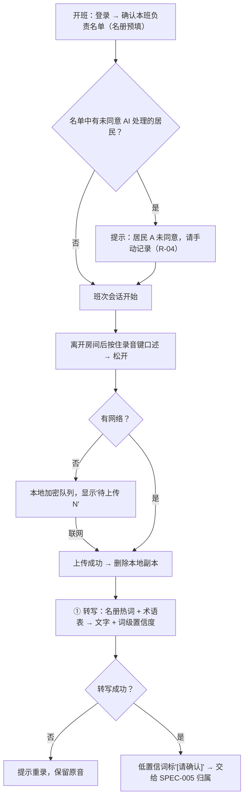

# 班次语音采集与转写 Shift Voice Capture & Transcription

| 项 | 内容 |
|---|---|
| 文档 ID | SPEC-004 |
| 类型 | 功能 spec（P0 / MVP）：班次会话、按键口述、离线加密队列、转写（ASR） |
| 版本 | v0.1 草稿 · 2026-10-19 |
| Owner | Terry（Product Owner + Tech Lead） |
| 状态 | 🟡 **待 Terry 审阅**（🛑 人工确认）；转写评测阈值待 Clinical Lead（待招）审阅 |
| 难度 | **L3**（[PRD 分配规范](../../11-rules/prd-assignment-rules.md) §2）：改变 AI 输入质量（① 转写）、设备端加密、涉及 `mobile-app` + `api` + `ai-pipeline/transcription` 3 个模块、需转写供应商决策 |
| 关联 | [docs/PRD.md](../../../docs/PRD.md) B3 核心概念、B4 模式 A、C2 ①、D2 一个班次、D9 异常与失败、E1 R-01~R-04、E2 T-01/T-03、E7；下游：[SPEC-005 居民归属](2026-10-resident-attribution.md)、[SPEC-006 草稿生成与护栏](2026-10-draft-generation-guardrails.md) |

> ⚠️ 本文中的法律判断为内部工作底稿，不构成法律意见。本 spec 只细化 PRD 已定范围，**不改变产品边界**（录音模式仍为 B4 模式 A 按键口述，DR-004），无需新 DR。
>
> **第一阶段范围（Terry 2026-10-19）**：本 spec 的护士端界面为规划；第一阶段只在护士端最小演示页中实现录音 / 上传与转写（R-01、R-03、R-04、T-01、T-03），见 PRD C1。

---

## 1. 问题

- 护理人员整班在走动、戴手套、被打断，没有时间坐下来打字；班末凭记忆补写导致不及时、不准确（[documentation-workflows](../../03-legal-compliance/research/aged-care-documentation-workflows.md) §3、§11 第 1–2 条 accurate / contemporaneous）
- 养老院网络常不稳定（走廊、地下层）；若录音因断网丢失，护士会失去信任并回到纸笔 —— PRD E7 要求"绝不静默丢失输入"
- 药名、剂量、数字、居民姓名的转写错误直接造成记录错误（hazard H-02）
- 护士原话：用户访谈尚未开始（`08-feedback/raw/` 为空），**不引用、不编造**；§9 的合成数据评测与 M0 原型测试是第一手证据来源

## 2. 目标与度量

对应 [PRD](../../../docs/PRD.md) G1 北极星"每班记录耗时下降 ≥ 50%"与 E7 性能、可靠性要求。

| 目标 | 度量 | 目标值 |
|---|---|---|
| 不丢输入 | 离线 / 断网 / 杀进程场景下丢失片段数（合成测试） | **0** |
| 录音即用 | 按下到开始录音的延迟 | ≤ 300 ms（M0 测得后复核） |
| 及时进入管线 | 联网时片段上传完成 → 转写完成 | 计入 E7"片段 → 草稿 ≤ 60 秒" |
| 转写质量 | 药名 / 数字 / 姓名准确率；低置信项被标"[请确认]"的召回率 | 基线在 M0 评测集测得后设定，不预设数字 |

## 3. 用户流程

## 4. 功能需求

| ID | 需求 | 优先级 |
|---|---|---|
| R-01 | 按住或点按录音，明显的视觉 + 触感提示；单段上限 3 分钟（机构可配置），到上限前提示 | P0 |
| R-01a | 录音界面显示简短提示："建议离开房间后口述；避免录到他人私人对话"（B4 UI 提示） | P0 |
| R-02 | 离线可录；本地**加密**缓存；联网自动上传；服务端确认收到后才删除本地副本（第一阶段为护士 Web App，完整离线队列降为 P1，见 PRD C1；R-02a 仍为 P0） | P1 |
| R-02a | "待上传 N"常驻显示；上传失败自动重试，不静默丢弃 | P0 |
| R-03 | 同班次所有片段汇入班次会话，按录音开始时间排序；保留"观察 / 口述时间"供 SPEC-006 区分签字时间 | P0 |
| R-04 | 开班检查负责名单的同意状态（M-02 只读）；未同意者提示手动记录，不阻止开班 | P0 |
| T-01 | 澳洲口音与养老环境噪音下转写；护理 / 药品术语表；本机构名册姓名、常用名、房号作热词；ASR 供应商为 **ElevenLabs**（Terry 2026-10-19 决定），数据在澳洲、零数据保留、不训练；真实居民录音前在 DPA 中书面确认（PRD C1、G4 #10） | P0 |
| T-03 | 低置信词（药名、剂量、数字、姓名）高亮并标"[请确认]"，置信度随转写传给下游 | P0 |
| T-03a | 转写结果保留词级时间戳，供审核时"一键回听"（D-03） | P0 |

## 5. 范围 / 不做什么

- **做**：手机 / 平板 App 按键口述（模式 A）、离线加密队列、ASR 转写与低置信标记
- **不做**：环境录音或整班连续录音（模式 B/C，需 DR-006）；声纹识别说话人（A-06）；挂绳蓝牙按键（R-05，P1）；共享设备快速切换（R-06，P1）；多语言口述与回译（T-02，P1）
- 本 spec 不负责拆分与归属（SPEC-005）、草稿生成（SPEC-006）、审核签字（E5）

## 6. 失败与安全

| 情况 | 系统行为（安全失败） |
|---|---|
| 无网络 / 上传中断 | 加密缓存，自动重试；在服务端确认前不删本地副本（D9） |
| 转写失败 | 提示重录，保留原音；不生成任何草稿 |
| 转写低置信 | 标"[请确认]"进入审核；不自动"纠正"成猜测的药名或数字 |
| 设备丢失 | 本地缓存加密；远程注销与擦除（D9、H-13） |
| 片段涉及未同意居民 | 由 SPEC-005 按 C3 第 5 条立即丢弃转写与原音片段 |

**建议 hazard**（待 Clinical Lead 审阅后由人加入 hazard log，本 spec 不修改 hazard log）：
- **H-19** 离线片段在上传前因 App 被清理、存储满或用户登出而丢失，护士以为已记录 → 缓解：服务端确认后才删除；"待上传 N"常驻；登出前提示未上传片段
- **H-20** 名册热词使 ASR 把相似发音的词偏向居民姓名（误插入姓名），放大 H-03 → 缓解：姓名类词一律带置信度并在审核中显示原音；评测集含近音难例

## 7. 法律依据 Legal References

> 查阅日期：2026-10-19 ｜ 依据 [法律参考索引](../../11-rules/legal-reference-index.md) ｜ ⚠️ 内部工作底稿，非法律意见

| 话题 | 本地文件（章节） | 对设计的影响 |
|---|---|---|
| 录音同意 | [recording-consent.md](../../03-legal-compliance/recording-consent.md)（DR-004 默认值）；[state-by-state-comparison.md](../../03-legal-compliance/research/state-by-state-comparison.md) §2、§9 | 只做按键口述；UI 提示离开房间后口述（R-01a）；不做环境录音 |
| 隐私、健康信息、数据驻留 | [privacy-program.md](../../03-legal-compliance/privacy-program.md) §2、§3；[federal-law-summary.md](../../03-legal-compliance/research/federal-law-summary.md) §2 | 原音为健康信息：设备端加密、ASR 不训练且零保留；原音按 C7 保留后删除；ElevenLabs 在澳洲存储与处理，DPA 书面确认后再处理真实录音（APP 8、NSW HPP 14、VIC HPP 9） |
| AI 透明与同意 | [federal-law-summary.md](../../03-legal-compliance/research/federal-law-summary.md) §4、§5；[aged-care-documentation-workflows.md](../../03-legal-compliance/research/aged-care-documentation-workflows.md) §12 第 5、7、11 条 | 开班同意检查（R-04）；数据在澳洲处理 |
| 记录及时与准确 | [aged-care-alignment.md](../../03-legal-compliance/aged-care-alignment.md)；[aged-care-documentation-workflows.md](../../03-legal-compliance/research/aged-care-documentation-workflows.md) §11 第 1–2 条 | 随时口述 + 保留观察时间戳（R-03） |
| 员工监控（NSW） | [compliance-register.md](../../03-legal-compliance/compliance-register.md)；[state-by-state-comparison.md](../../03-legal-compliance/research/state-by-state-comparison.md) §2 | 录音元数据不用于个人绩效；上线前员工书面通知（PRD D1） |

| 各州录音法与跨州数据（深挖） | [state-deep-dive-nsw-vic-act.md](../../03-legal-compliance/research/state-deep-dive-nsw-vic-act.md)；[state-deep-dive-qld-wa-sa-tas-nt.md](../../03-legal-compliance/research/state-deep-dive-qld-wa-sa-tas-nt.md) | 护士单人口述一般不构成"私人对话"（NSW、ACT 定义），支持模式 A（需律师书面确认）；环境录音在多数辖区实际需全体同意 → 维持 DR-004；NSW HPP 14、VIC HPP 9、TAS、NT 管"出州"→ 托管区域须在合同中写明 |

**需律师确认**：(1) 模式 A 背景中录到居民或他人声音在 NSW、WA、SA、TAS、ACT 的风险（PRD F3）；(2) 录音元数据与上传日志是否构成 NSW Workplace Surveillance Act 2005 下的监控；(3) CareKind 侧原音保留期（PRD G4 #6）。
**合规检查**：尚未运行；定稿前按 L-7 运行 skill `compliance-check`。总 PRD 检查见 [checks/2026-10-10_prd.md](../../03-legal-compliance/checks/2026-10-10_prd.md)。

## 8. 检查清单

- [x] 法律依据已填写，`check_rules.py` 通过
- [x] TGA 判定：是否生成诊断 / 治疗 / 用药建议？**否**（只采集与转写）
- [ ] 临床 hazard：建议 H-19、H-20，待 Clinical Lead 审阅后由人加入
- [ ] 隐私：原音与转写已在 PRD F2 范围内；PIA（PIA-2026-001）须覆盖离线缓存
- [ ] 新子处理方：ASR 为 ElevenLabs（已登记到子处理方清单，状态"评估中"）；须在 DPA 中书面确认澳洲存储与处理、零保留、不训练
- [ ] 可访问性：大按钮、单手、触感反馈（DESIGN.md）；多语言为 P1

## 9. 评测计划

| 评测 | 方法（只用合成数据，不用真实居民） | 通过标准 |
|---|---|---|
| 离线可靠性 | 自动化测试：断网录 50 段、录音中杀进程、存储接近满、登出 | 丢失 0 段；本地副本仅在服务端确认后删除 |
| 转写准确率 | PRD F5 合成班次录音（演员、澳洲 + CALD 口音、养老院噪音）；合成名册含近音姓名 | 报告药名 / 数字 / 姓名准确率与"[请确认]"召回率；建立基线 |
| 热词副作用 | 含近音词但未提及居民的片段（如"medication / mediation"） | 误插入居民姓名 = 0（H-20） |
| 性能 | 联网片段端到端计时；班末 40 段批处理 | 满足 E7 |
| 加密检查 | 检查设备本地存储与日志 | 无明文音频、无健康信息明文日志 |
