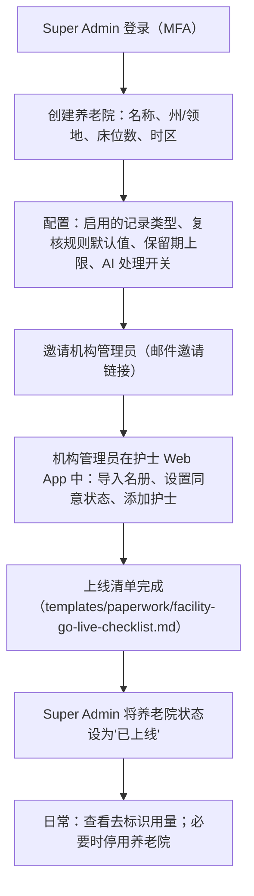

# Super Admin 控制台（多养老院管理）

| 项 | 内容 |
|---|---|
| 文档 ID | SPEC-010 |
| 类型 | 平台功能：CareKind 内部使用的独立 React JS 应用（`src/super-admin/`） |
| 版本 | v0.1 草稿 · 2026-10-19 |
| Owner | Terry（Product Owner + Tech Lead） |
| 状态 | 🟡 **待 Terry 审阅**（🛑 人工确认） |
| 难度 | **L2**：不涉及 AI 输出与临床内容，但涉及多租户隔离与平台权限 |
| 关联 | [docs/PRD.md](../../../docs/PRD.md) B2、C1、C6、E6（SA-01–SA-04）、D1 机构上线；[SPEC-009 同意管理](2026-10-consent-management.md)；[product-feature-map.md](../product-feature-map.md) |

> ⚠️ 本文中的法律判断为内部工作底稿，不构成法律意见。本 spec 不改变产品边界（TGA、录音模式、HITL、数据驻留）。前端形态的决定（护士 Web App + Super Admin App）由 Terry 于 2026-10-19 作出，已写入 PRD C1。

## 1. 问题

- 第一阶段就要服务多家养老院（试点 2 家起）。每家都要开通、配置、分配管理员账号；没有平台控制台，只能改数据库，容易出错、无审计
- CareKind 员工如果能随意看到各院居民记录，就违背"最小必要"与 DPA 中"处理方"角色 —— 平台管理必须与居民健康信息隔离
- 用户访谈尚未开始，不引用护士原话

## 2. 目标与度量

| 目标 | 度量 | 目标值 |
|---|---|---|
| 新养老院开通快 | 从创建租户到机构管理员首次登录 | ≤ 30 分钟（不含机构内部准备） |
| 租户隔离 | 跨租户访问测试 | 0 次成功 |
| 平台方不接触健康信息 | Super Admin 界面/API 返回中含居民姓名、记录、原音、转写 | 0 |
| 可追溯 | 平台操作写入审计 | 100% |

## 3. 用户流程

## 4. 功能需求

| ID | 需求 | 优先级 |
|---|---|---|
| SA-01 | 养老院（租户）列表、创建、编辑、停用；状态：配置中 / 已上线 / 已停用。停用后该院用户无法登录，数据按合同保留，不删除 | P0 |
| SA-01a | 每个 API 请求在服务端按租户过滤；租户 ID 来自登录凭证，不信任前端传入 | P0 |
| SA-02 | 每家养老院配置：启用的记录类型（MVP：progress note、ADL）、PCW 记录是否需 RN 复核（默认值）、原音保留期（≤ 平台上限 7 天）、AI 处理总开关 | P0 |
| SA-02a | 平台默认配置：新建养老院时自动套用，可逐院覆盖；配置变更写审计 | P0 |
| SA-03 | 邀请、重发邀请、停用机构管理员；Super Admin 账号强制 MFA；平台角色：Super Admin / 只读支持 | P0 |
| SA-04 | 用量看板（按养老院、按周）：片段数、签字数、活跃用户数、待归属比例 —— 只汇总数字，**不出现个人排名**（PRD S-07） | P0 |
| SA-04a | 平台审计日志：谁、何时、对哪家养老院做了什么；只追加 | P0 |
| SA-05 | Super Admin 界面与 API **不提供**居民名册、记录、原音、转写的查看入口 | P0 |
| SA-06 | 支持访问（break-glass，经机构书面授权、限时、全程审计） | P2（不做） |

## 5. 范围 / 不做什么

- 不做计费与发票（手工处理）
- 不做集团层级（平台 → 集团 → 养老院）—— 第一阶段只有平台 → 养老院
- 不代机构录入名册或同意状态（机构管理员在护士 Web App 中完成，见 SPEC-009）
- 不做 break-glass 访问居民数据
- 不做 SSO 对接（机构管理员用邮件邀请 + 密码 + MFA；SSO 后续）

## 6. 失败与安全

- 租户过滤缺失 = 最严重缺陷：每个数据接口都有跨租户自动化测试；失败即阻止发布
- 停用养老院时只阻止登录、保留数据；误停用可恢复，操作二次确认
- 修改 AI 处理开关或保留期立即生效并通知该院机构管理员
- 建议新增 hazard（编号待 Clinical Lead 加入 hazard log 时分配）：租户隔离失效导致 A 院人员看到 B 院居民记录 → 缓解：服务端强制过滤 + 跨租户测试 + 审计告警

## 7. 法律依据 Legal References

> 查阅日期：2026-10-19 ｜ 依据 [法律参考索引](../../11-rules/legal-reference-index.md) ｜ ⚠️ 内部工作底稿，非法律意见

| 话题 | 本地文件（章节） | 对设计的影响 |
|---|---|---|
| 隐私、最小必要、处理方角色 | [privacy-program.md](../../03-legal-compliance/privacy-program.md)；[federal-law-summary.md](../../03-legal-compliance/research/federal-law-summary.md) §2（APP 6、APP 11） | 平台方不可见居民健康信息（SA-05）；用量只给去标识汇总（SA-04） |
| 州健康隐私法与跨州数据 | [state-deep-dive-nsw-vic-act.md](../../03-legal-compliance/research/state-deep-dive-nsw-vic-act.md)；[state-deep-dive-qld-wa-sa-tas-nt.md](../../03-legal-compliance/research/state-deep-dive-qld-wa-sa-tas-nt.md) | 养老院记录"州/领地"字段（SA-01），用于确定适用州法与托管区域说明；VIC、TAS、NT 客户的出州限制写入合同 |
| 记录保存与删除 | [privacy-program.md](../../03-legal-compliance/privacy-program.md) §2；[state-by-state-comparison.md](../../03-legal-compliance/research/state-by-state-comparison.md) §6 | 停用不删除数据；原音保留期设平台上限（SA-02） |
| 网络安全 | [compliance-register.md](../../03-legal-compliance/compliance-register.md) §6 | 平台账号强制 MFA；平台审计只追加（SA-03、SA-04a） |
| 员工监控 | [state-by-state-comparison.md](../../03-legal-compliance/research/state-by-state-comparison.md) §2 | 用量看板不做个人排名、不用于绩效 |
| TGA | [tga-samd-assessment.md](../../03-legal-compliance/tga-samd-assessment.md) | 平台管理不涉及临床功能，非器械 |

**需律师确认**：(1) DPA 中 CareKind 员工"不访问居民数据"的承诺与运维排障需求如何平衡（是否需要 break-glass 条款）；(2) 用量数据（片段数、活跃用户数）在何种粒度下仍属去标识信息。
**合规检查**：未运行 —— 定稿前运行 skill `compliance-check`（L-7）。

## 8. 检查

- [x] 法律依据已填写，`python company-os/11-rules/check_rules.py` 通过
- [x] TGA 判定：是否生成诊断/治疗/用药建议？**否**
- [ ] 临床 hazard 已加入 hazard log：建议项见 §6，待 Clinical Lead
- [x] 隐私：无新健康数据类型；新增平台审计与用量数据，纳入 PIA
- [x] 新子处理方/新模型：无
- [x] 可访问性：桌面浏览器，WCAG 2.2 AA；UI 遵循 [DESIGN.md](../design-system/DESIGN.md)

## 9. 评测计划

- 跨租户访问自动化测试：用 2 家合成养老院，逐个接口尝试读写对方数据，期望全部拒绝
- 平台 API 响应字段扫描：确认不含居民姓名、记录正文、原音或转写链接
- 开通演练：从创建租户到机构管理员首次登录，计时 ≤ 30 分钟
